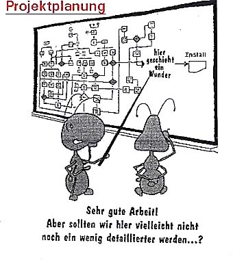

# M306/2 Projekt-Planung

> 🤖 **Copilot-Agents:** [M306 T02a Planung Grundlagen](https://m365.cloud.microsoft/chat/?titleId=T_02ad6130-2c1a-6e79-5629-a8c7d800a280&source=embedded-builder) · [M306 T02b Planungsmethoden](https://m365.cloud.microsoft/chat/?titleId=T_4e76160e-bd57-9d13-7eba-44e8a608a967&source=embedded-builder) — mit dem TBZ-Konto öffnen und **Start** tippen.

## Theorie
- [Skript V3.1.5 (Seiten 16-24)](../docs) 
- **Beispiel**: Dokumentenplanung "Hermes" im Kanton Zürich [Szenario-Übersicht](http://hermes.zh.ch/szenarien/szenario_01_IT-Individualanwendung/scenariooverview/de/Szenariouebersicht.pdf), [Vorlagen](http://hermes.zh.ch/szenarien/szenario_01_IT-Individualanwendung/templates/de/index.html)

## 1 Projekt-Rollen und Zusammenarbeit
- (4:40 min) [Rollen im Projekt - Wer macht was](https://www.youtube.com/watch?v=JQYLg-n_iZE&list=PLdPuPEPdfsEbu55aREtpwjtPALYrekPVO&index=5)

## 2 Planung
- (3:40 min) [Planung macht Sinn. Warum sollte ich eigentlich planen?](https://www.youtube.com/watch?v=9nliP9mefXo&list=PLdPuPEPdfsEbu55aREtpwjtPALYrekPVO&index=10)
- (4:31 min) [Der Planungsprozess. Wie kann ich strukturiert planen?](https://www.youtube.com/watch?v=1wbtRrJiPVA&list=PLdPuPEPdfsEbu55aREtpwjtPALYrekPVO&index=11)

## 3 Strukturplan und Ablaufplan
- (3:25 min) [Der Projektstrukturplan - Wie unterteilen wir unser Projekt- (Teil 1)](https://www.youtube.com/watch?v=mTgMiIMHpW0&list=PLdPuPEPdfsEbu55aREtpwjtPALYrekPVO)
- (4:55 min) [Der Projektstrukturplan - Wie unterteilen wir unser Projekt- (Teil 2)](https://www.youtube.com/watch?v=VWp6W-KAQ-A&list=PLdPuPEPdfsEbu55aREtpwjtPALYrekPVO&index=12)
- (3:16 min) [Der Projektablaufplan (Teil 1) - den fachlichen Ablauf festlegen](https://www.youtube.com/watch?v=dotv2MKuN0M&list=PLdPuPEPdfsEbu55aREtpwjtPALYrekPVO&index=13)
- (3:14 min) [Der Projektablaufplan (Teil 2) - den fachlichen Ablauf festlegen](https://www.youtube.com/watch?v=LlHSf42FDXA&list=PLdPuPEPdfsEbu55aREtpwjtPALYrekPVO&index=14)

## 4 Netzplantechnik
- (25 min) [**Tutorial**: Netzplantechnik und Durchlaufterminierung](https://www.youtube.com/watch?v=HkXlzWYBBAU)
- (15 min) [Entwicklung Netzplan - Projektmanagement](https://www.youtube.com/watch?v=fYoZErkiMTk)
- (11 min) [Netzplantechnik erklärt](https://www.youtube.com/watch?v=bUUrnbjKSbs)

## 5 GANTT-Diagramm, Balken-Diagramm
- (13 min) [Anleitung, wie man in Excel ein "richtiges" GANTT macht](https://www.youtube.com/watch?v=DGxL2ynLexw)
- (15 min) [Excel - Gantt-Diagramm mit Meilensteinen und Ressourcen](https://www.youtube.com/watch?v=vsgI2VOVGuQ)

## 6 Critical Path Method (CPM), Netzplan und GANTT
- (4:33 min) [Vergleich von Netzplan und GANTT Diagramm](https://www.youtube.com/watch?v=PkZhHaxyZR4)
- (3:30 min) [Developing a Basic Gantt Chart - Bar Chart Using Critical Path Method (CPM)](https://www.youtube.com/watch?v=mCXyUiexj0o)

## 7 Lastenheft, Pflichtenheft
- [Was ist ein Lastenheft, was ein Pflichtenheft](https://www.peterjohann-consulting.de/lastenheft-und-pflichtenheft/)
- [Das Pflichtenheft](https://www.ionos.de/digitalguide/websites/web-entwicklung/pflichtenheft)
- (5:51 min) [Lastenheft und Pflichtenheft (Teil 1)](https://www.youtube.com/watch?v=Wim8hgTv_OQ&t=134s)
- (4:24 min) [Lastenheft und Pflichtenheft (Teil 2)](https://www.youtube.com/watch?v=hlltEc5k4F4)
- (13 min) [Lasten- und Pflichtenheft. Warum brauche ich das z.B. als Webdesigner?](https://www.youtube.com/watch?v=-4Tq83wZFw8&t=1s)

## Auftrag
Der Auftrag zu diesem Kapitel (Quellfassung) steht im Lernpfad:
**[Tag 2 · Projektplanung](../sol/02.md)**
