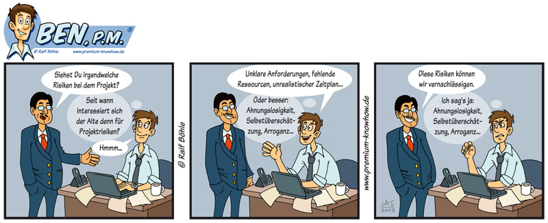
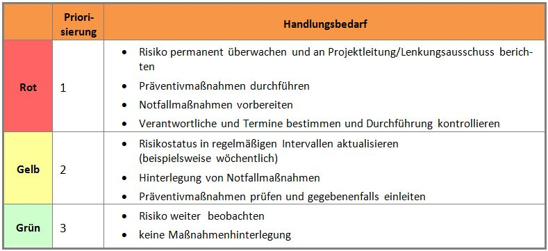

# M306/6 Projekt-Risiken und Risikoanalyse

- [Projektkontrolle-risiken_Praeinstruktion](./M306_6a_Projektkontrolle-risiken_Praeinstruktion.txt)

 

 
  
  
 

**Priorisierung von Risiken**

## Theorie
- [Skript V3.1.5 (Seiten 53-54)](../docs) 
- 6:20 min [Risiken im Projekt managen 1](./M306_6f_Teil1_6.20min_Risiken-im-Projekt-managen.mp4) mp4 
- 5:07 min [Risiken im Projekt managen 2](./M306_6f_Teil2_5.07min_Risiken-im-Projekt-managen.mp4) mp4
- 5:47 min [Risiken im Projekt managen 3](./M306_6f_Teil3_5.47min_Risiken-im-Projekt-managen.mp4) mp4
- 4:11 min [Ich hasse Verluste](https://fintool.ch/videos/5d542a04fefe66725d329b8b/unterschiedliche-verhaltensweisen-d?token=9cdda1996405aebf16a100ba00d57d45) [YT](https://www.youtube.com/watch?v=-MUlLja07Yc)

## Praxis & Artikel
- [Projektkontrolle/-Ablauf Praxisfragen](./M306_6b_ProjektkontrolleUndAblauf_Praxisfragen.pdf)
- [Risikoanalysetabelle](./M306_6d_Risikoanalysetabelle.png)
- [Risikofelder](./M306_6e_Risikofelder.pdf)
- **Artikel**
	- A1: [Zu viele strategische IT-Projekte sind krank-und daher gefährdet](./M306_6c_Zu viele strategische IT-Projekte sind krank-und daher gefährdet.pdf)
	- A2: [Projektrisiken erfolgreich managen](https://www.informatik-aktuell.de/management-und-recht/projektmanagement/it-projektrisiken-erfolgreich-managen.html)
	- A3: [130 Projektrisiken, die auch dein Projekt treffen könnten](https://projekte-leicht-gemacht.de/blog/methoden/projektrisiken/130-projektrisiken-beispiele)
	- A4: [Projekt-Risiken analysieren und bewerten](https://www.hettwer-beratung.de/projekte/projektrisiken-und-restriktionen/risiken-analysieren-und-bewerten)
	- A5: [Risikomanagement aus 'orghandbuch.de'](https://www.orghandbuch.de/OHB/DE/Organisationshandbuch/7_Management/72_Risikomanagement/risikomanagement-node.html)
	- A6: [Risikomanagement Software 'Opture'](https://www.opture.com/risikomanagement-software.html)

## Aufgabe
- U1: [Übung "Logic"](../uebungen/M306_6g_ProjektkontrolleUndAblauf_Uebung_Logic.pdf)
