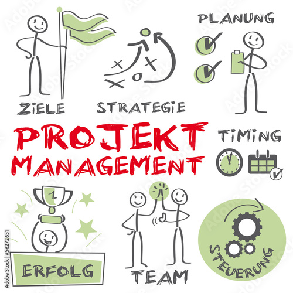
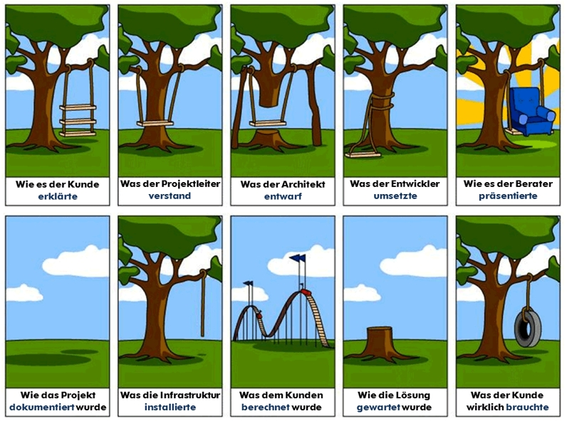
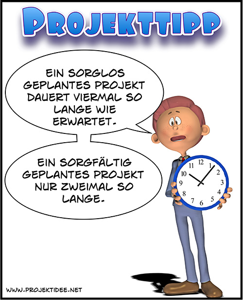

# M306 - Kleinprojekte im eigenen Berufsumfeld abwickeln

**Modulidentifikation**
[Modulidentifikation: ICT-Berufsbildung](https://www.modulbaukasten.ch/module/306/4/de-DE?title=Kleinprojekte-im-eigenen-Berufsumfeld-abwickeln)

 

 
 
 

[TOC]

 
 

## Tages- und Themenplan

| ~Tag | Datum     | Thema                                                                          | Bemerkungen               |
| ---- | -----     | ----                                                                           | ----                      |
|   1  |   | [Projekt-Ziele                        ](./1_Projekt-Ziele)                     |                           |
|   2  |   | [Projekt-Planung                      ](./2_Projekt-Planung)                   | Ecolm-Test P-Zie 7% MNote |
|   3  |   | [Projekt-Organisation                 ](./3_Projekt-Organisation)              | Ecolm-Test P-Pla 7% MNote |
|   4  |   | [Projekt-Führung                      ](./4_Projekt-Fuehrung)                  | Ecolm-Test P-Org 7% MNote |
|   5  |   | [Projekt-Kontrolle und Vorgangsmodelle](./5_Projekt-Kontrolle-Vorgangsmodelle) | Ecolm-Test P-Füh 7% MNote |
|   6  |   | [Projekt-Risiken und Risikoanalyse    ](./6_Projekt-Risiken-Risikoanalyse)     | Ecolm-Test P-Kon 7% MNote |
|   -  | -Ferien-  |                                                                                |                           |
|   7  |   | [Qualitätsicherung                    ](./7_Qualitaetsicherung)                | Gruppen-Projekt 32% MNote |
|   8  |   | [Abschlussprojekt                     ](./Abschlussprojekt)                    |                           |
|   9  |   | [Abschlussprojekt                     ](./Abschlussprojekt)                    | Gruppen-Projekt 33% MNote |
|      |           |                                                                                |                           |
|  add on |  1     | [Lastenheft-Pflichtenheft](./add-on1_Lastenheft-Pflichtenheft)                 |                           |
|  add on | 2  | [Warum Projekte scheitern](./add-on2_Warum-Projekte-scheitern)           |                          

 
 
 [TIME](https://www.youtube.com/watch?v=JwYX52BP2Sk)
 [MONEY](https://www.youtube.com/watch?v=cpbbuaIA3Ds)

