IT Kleinprojekt abwickeln   
Modul 306

Technische Berufsschule Zürich

Version 3.1.3 (2019)

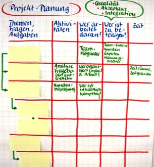

Inhaltsverzeichnis

[1 Projektstart und -ziele](#projektstart-und--ziele)

[1.1 Was ist ein Projekt](#was-ist-ein-projekt)

[1.2 Wie Projekte entstehen](#_Toc22657349)

[1.3 Ziele ermitteln – Zielkreuz](#_Toc22657350)

[1.4 Ziele müssen SMART sein](#_Toc22657351)

[1.4.1 Beispiel](#beispiel)

[1.4.2 Typische Fallen](#typische-fallen)

[1.4.3 Zielkategorien, das magische Dreieck (Teufelsdreieck)](#_Toc22657354)

[1.5 Baseline](#_Toc22657355)

[1.6 Exceptions Management](#exceptions-management)

[1.6.1 Change Management](#_Toc22657357)

[1.7 Der Projektstart](#der-projektstart)

[1.7.1 Typische Aufgaben des Projektleiters beim Projektstart](#typische-aufgaben-des-projektleiters-beim-projektstart)

[1.8 Der Projektauftrag (Teil der Baseline)](#der-projektauftrag-teil-der-baseline)

[2 Organisation](#organisation)

[2.1 Unternehmensorganisation und ihre Dienstwege](#unternehmensorganisation-und-ihre-dienstwege)

[2.1.1 Die Linien-Organisation](#die-linien-organisation)

[2.1.2 Die Stab-Linien-Organisation](#die-stab-linien-organisation)

[2.1.3 Die funktionale Organisation, Mehrliniensystem](#die-funktionale-organisation-mehrliniensystem)

[2.1.4 Die Matrix-Organisation](#die-matrix-organisation)

[2.2 Projektorganisation](#projektorganisation)

[2.2.1 Reine Projektorganisation](#reine-projektorganisation)

[2.2.2 Matrix-Projektorganisation](#matrix-projektorganisation)

[2.2.3 Stab-Linien-Projektorganisation](#stab-linien-projektorganisation)

[3 Die Rolle des Projektleiters und Projektleitung](#die-rolle-des-projektleiters-und-projektleitung)

[3.1 Teambildung](#teambildung)

[3.2 Soziales Faulenzen (social loafing)](#_Toc22657373)

[3.3 Effektive Sitzungen](#effektive-sitzungen)

[3.3.1 Was sind typische Fallen bei Teambesprechungen?](#was-sind-typische-fallen-bei-teambesprechungen)

[3.3.2 Tipps & Regeln für gute Teambesprechungen](#tipps--regeln-für-gute-teambesprechungen)

[3.3.3 Checkliste zur Sitzungsvorbereitung](#_Toc22657377)

[3.3.4 Sitzungstypen](#sitzungstypen)

[3.4 Das Pareto-Prinzip, bzw. 80/20-Regel](#das-pareto-prinzip-bzw-8020-regel)

[3.5 Das Eisenhower-Prinzip](#das-eisenhower-prinzip)

[3.6 Entscheidungsfolgen-Matrix](#entscheidungsfolgen-matrix)

[4 Projektablauf & Vorgehensmodelle](#projektablauf--vorgehensmodelle)

[4.1 Von der Chaostheorie zum Projektablauf](#von-der-chaostheorie-zum-projektablauf)

[4.2 Ziele methodischen Vorgehens](#ziele-methodischen-vorgehens)

[4.3 Project Life Cycle](#project-life-cycle)

[4.3.1 Meilensteine](#meilensteine)

[4.4 Phasenmodelle (klassisch)](#phasenmodelle-klassisch)

[4.5 Iterative Vorgehensmodelle (Agil)](#iterative-vorgehensmodelle-agil)

[4.5.1 Manifest für Agile Softwareentwicklung](#manifest-für-agile-softwareentwicklung)

[4.5.2 Phasenmodelle vs. Iterative Vorgehensmodelle](#phasenmodelle-vs-iterative-vorgehensmodelle)

[5 Planung](#planung)

[5.1 Ein paar banale Wahrheiten](#ein-paar-banale-wahrheiten)

[5.2 Wer plant?](#wer-plant)

[5.3 Ziele der Projektplanung](#ziele-der-projektplanung)

[5.4 Planungsobjekte](#planungsobjekte)

[5.5 Planungsmethoden](#planungsmethoden)

[5.5.1 WBS/PSP (Work Breakdown Structure / Projekt Struktur Plan)](#wbspsp-work-breakdown-structure--projekt-struktur-plan)

[5.5.2 PERT](#pert)

[5.5.3 CPM](#cpm)

[5.5.4 MPM](#mpm)

[5.5.5 Gantt](#gantt)

[5.6 Planung Kommunikations- und Dokumentationssystems](#planung-kommunikations--und-dokumentationssystems)

[5.6.1 Dokumentenmanagementsystem](#dokumentenmanagementsystem)

[6 Risikoanalyse](#risikoanalyse)

[6.1 Risikomatrix](#risikomatrix)

[6.2 Vorgehensweise bei der Risikoanalyse](#vorgehensweise-bei-der-risikoanalyse)

[6.3 Risikoanalysetabelle](#risikoanalysetabelle)

[7 Qualitätsmanagement](#qualitätsmanagement)

[7.1 Begriffe](#begriffe)

[7.1.1 Qualität](#qualität)

[7.2 Qualitätsmanagement](#qualitätsmanagement-1)

[7.3 Forderungen der Norm ISO 9001](#forderungen-der-norm-iso-9001)

[7.3.1 Prüfplan](#prüfplan)

[7.4 Prinzipien eines modernen Qualitätsmanagementsystems](#prinzipien-eines-modernen-qualitätsmanagementsystems)

[7.4.1 Moderne integrierte Management-Systeme](#moderne-integrierte-management-systeme)

# Projektstart und -ziele

In diesem Teil beschäftigen wir uns mit **Zielen**, der Zieldefinition, Zielformulierung und den Schwierigkeiten, die damit verbunden sind. Am Schluss sollten wir uns einig sein darüber, was am **Start eines Projektes** zu machen ist.

Diese Fragen wollen wir klären:

-   *Was sind Ziele?*
-   *Welches sind Techniken zur Zielfindung?*
-   *Was macht einen Projektauftrag aus?*
-   *Was ist eine Baseline?*
-   *Welches sind die Aufgaben des Projektleiters im Rahmen der Projektdefinition (Bestimmung des Projektauftrages)?*
-   *Wie wird ein Projekt bei angefangen? Was wollen wir beibehalten, was verbessern?*
-   *Was bedeutet Change Management und wie setzt man es um?  
    *

Mögliche Resultate zur Erarbeitung:

-   Checkliste / Standardvorlage für "**Projektauftrag** (Projektdefinition)
-   Checkliste / Standardvorlage für "**Änderungsantrag**" (Change-Management)

## Was ist ein Projekt

Ein **Projekt** ist ein zielgerichtetes, **einmaliges** **Vorhaben**, das aus einem Satz von abgestimmten, gesteuerten Tätigkeiten **mit Anfangs- und Endtermin** besteht und durchgeführt wird, um unter Berücksichtigung von Vorgaben bezüglich

-   (Arbeits-)**Zeit**,
-   **Ressourcen** (Kosten, Produktionsbedingungen, Personal / Betriebsmittel) und
-   **Qualität** (Leistung, Inhalt und Umfang)

ein Ziel zu erreichen. *(Quelle Wiki)*

Als **Stakeholder** (dt. „Teilhaber“) wird eine Person (oder Gruppe) bezeichnet, die ein berechtigtes Interesse am Verlauf oder Ergebnis **Projektes** hat.

**Praxis**: *Die Bandbreite der in der Praxis anzutreffenden Formate für den Projektauftrag reicht vom einfachen mündlichen Zuruf ("Maier, Sie übernehmen das Projekt '0815'!") bis hin zum mehrere hundert Seiten starken Vertragswerk, das zwischen den Juristen der Vertragsparteien über Monate, wenn nicht sogar Jahre ausgehandelt wird, z.B. bei der Vergabe von Großprojekten im Aerospace- oder Verteidigungsbereich.*

*(Quelle:* [*www.projektmagazin.de*](http://www.projektmagazin.de)*)*

## Wie Projekte entstehen

Was sind eigentlich die Gründe, ein Projekt durchzuführen?

-   Man will einen neuen Zustand in der Zukunft erreichen
-   Man will ein Problem lösen bzw. beseitigen

Der erwünschte Zustand in der Zukunft wird zum Projekteziel.

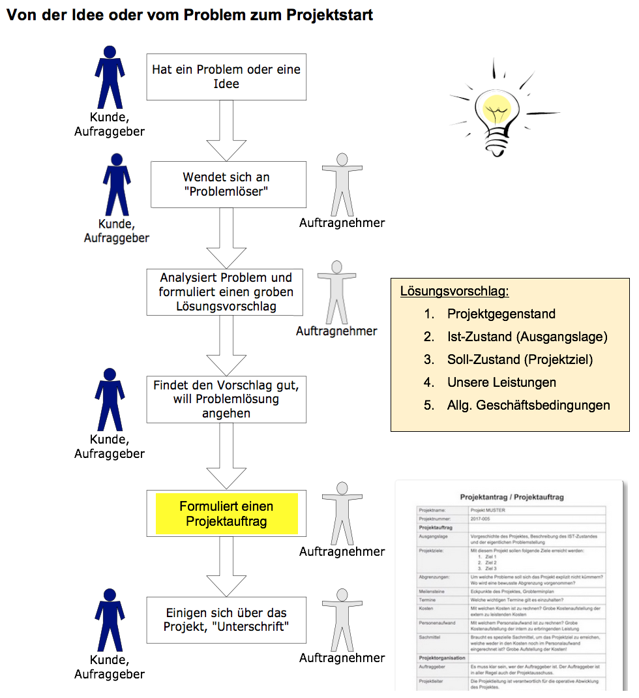

## Ziele ermitteln – Zielkreuz

Das **Zielkreuz** ist besonders gut geeignet **zur Zielermittlung** in Workshops.

1.  Die erarbeiteten Ergebnisse werden **grafisch dargestellt**.
2.  Pro Quadrant kann ein eigenes Flipchart genutzt werden.
3.  Am Ende fasst man alles zu einem Projektziel zusammen:

| 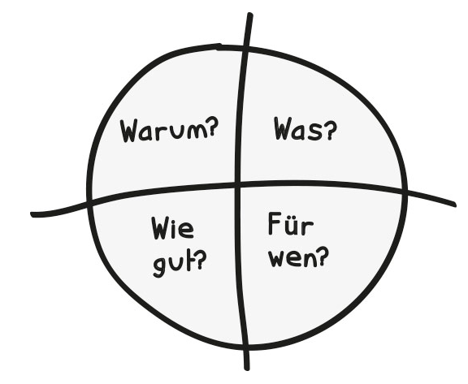 | **Warum? - Sinn und Zweck** Hier werden folgende Fragen beantwortet: Warum wird Projekt überhaupt durchgeführt? Welchen Nutzen versprechen wir uns davon?  **Was? - Das Ergebnis** An dieser Stelle wird definiert, was am Ende des Projektes als Ergebnis entstanden sein soll: Was ist das erwartete Endergebnis? Was soll geliefert werden?  **Für wen? - Stakeholder** Hier dreht sich alles um die betroffenen, interessierten und beteiligten Personen – die Stakeholder: Wer ist vom Projekt betroffen? Wer profitiert vom Projekt? Wer ist ein möglicher Gegner? Wer ist verantwortlich für das Projekt?  **Wie gut? - Messkriterien** Dieser Punkt steht in engem Zusammenhang mit dem Quadrant „Ergebnis“. Während dort das „Was?“ formuliert wird, geht es hier um das „Wie gut?“. Traditionell erscheinen hier harte Messkriterien: Woran wird das Ergebnis gemessen? Wie kann die geeignete Qualität geprüft werden? Welche Werte sagen aus, ob das Projekt erfolgreich ist?  |
|-------------------------------------------------|--------------------------------------------------------------------------------------------------------------------------------------------------------------------------------------------------------------------------------------------------------------------------------------------------------------------------------------------------------------------------------------------------------------------------------------------------------------------------------------------------------------------------------------------------------------------------------------------------------------------------------------------------------------------------------------------------------------------------------------------------------------------------------------------------------------------------------------------------------------------------------------------------------------------------------------------------------------------------------------------|

## Ziele müssen SMART sein

**SMART** ist ein Kürzel für **S***pecific* **M***easurable* **A***chievable* **R***easonable* **T***ime Bound* und dient im Projektmanagement als Kriterium zur eindeutigen Definition von Zielen im Rahmen einer Zielvereinbarung. Quelle Wiki

| **Buchstabe** | **Bedeutung** (Englisch) | **Bedeutung** (Deutsch) | **Beschreibung**                                                                                    | **Kontrollfragen**                                                                                                                 |
|---------------|--------------------------|-------------------------|-----------------------------------------------------------------------------------------------------|------------------------------------------------------------------------------------------------------------------------------------|
| **S**         | Specific                 | Spezifisch              | Ziele müssen eindeutig definiert sein (nicht vage, sondern so präzise wie möglich).                 | **Was genau soll erreicht werden?**  Welche Eigenschaften werden angestrebt? Wo soll das Ziel erreicht werden?  Wer ist beteiligt? |
| **M**         | Measurable               | Messbar                 | Ziele müssen messbar sein (Messbarkeitskriterien).                                                  | Woran kann die Zielerreichung gemessen werden?  Wie viel genau?  **Wann weiß ich, dass ich das Ziel erreicht habe?**               |
| **A**         | Accepted *Attractive*    | Akzeptiert *Attraktiv*  | Die Ziele müssen "accepted” (akzeptiert bzw. attraktiv) und einem Verantwortlichen zuweisbar sein.  | Wirkt das Ziel motivierend?  **Wird es von den Beteiligten akzeptiert?** **Ist es aktiv durch das Projekt erreichbar?**            |
| **R**         | Reasonable               | Realistisch             | Das gesteckte Ziel muss möglich und realisierbar sein.                                              | **Ist das gewünschte Ziel im Rahmen des**  **Projektes erreichbar?**  Ist es machbar?                                              |
| **T**         | Time-bound               | Terminiert              | Das Ziel muss mit einem fixen Datum festgelegt werden können.                                       | Bis wann soll das Ziel erreicht werden?  **Ist das Ziel innerhalb der Projektlaufzeit**  **erreichbar?**                           |

Quelle: <https://projekte-leicht-gemacht.de/blog/pm-methoden-erklaert/smarte-ziele-formulieren/>

### Beispiel

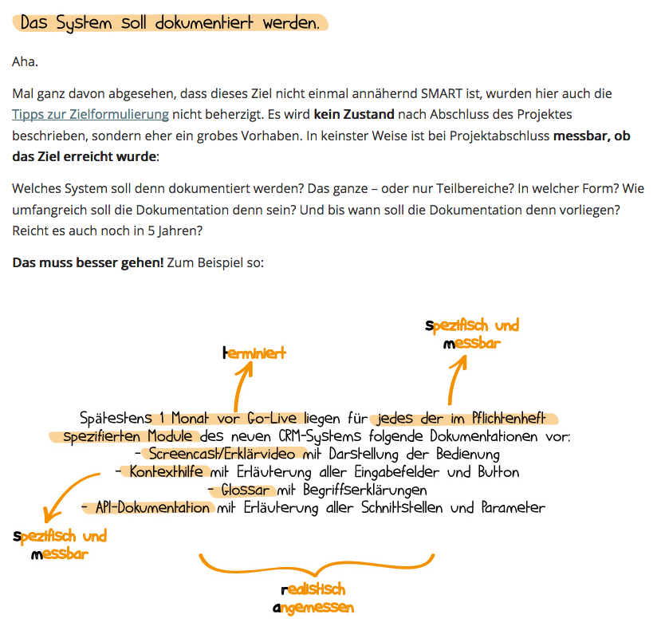  
Quelle: https://projekte-leicht-gemacht.de/blog/pm-methoden-erklaert/smarte-ziele-formulieren/

### Typische Fallen

Nebst der anspruchsvollen Ausformulierung der Ziele nach «SMART» kommen noch folgende Erschwernisse dazu:

-   Der Auftraggeber weiss oft selbst nicht so genau, was er eigentlich will. **Die Zielformulierung ist entsprechend vage**.
-   Man steht bereits vor **Projektbeginn unter Druck** und nimmt sich für die Zieldiskussion deshalb keine Zeit.
-   Die Beteiligten haben den **Lösungsweg schon „im Kopf“** und wollen sich nicht mit der Formulierung des „Zielzustandes“ aufhalten.

Wenn man in diese Fallen tappt, sind folgende **Konsequenzen** meistens der Fall:

-   **Die Kreativität leidet**. Man erarbeitet nicht die beste Lösung, sondern die erste, die einem in den Sinn kommt.
-   Die **Kundenzufriedenheit leidet**. Man hat ihn nicht wirklich verstanden, oder ihn nicht auf wirklich gute Ideen gebracht, oder die Resultate sehen immer gleich aus. Oder noch schlimmer: Man hat das Falsche gemacht.
-   Die **Qualität leidet**. Grundlegendes kommt erst im Laufe des Projektes ans Tageslicht und man schlägt sich endlos mit dem Einarbeiten von Änderungen um. Der daraus entstehende **Mehraufwand** ( Kosten, Zeit) will der Kunde dann nicht bezahlen.
-   **KO-Kriterien**: Bringen ein Projekt zu Fall. (Insolvenz, Firmenverkauf, Chefwechsel, ...)

### Zielkategorien, das magische Dreieck (Teufelsdreieck)

Projektziele lassen sich in der Regel in die 3 Kategorien **Qualität**, **Zeit** und **Kosten** unterteilen.

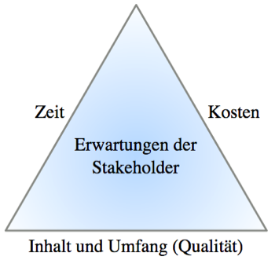 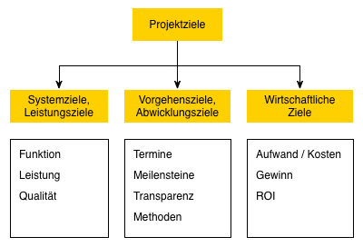

**Qualität, Systemziele und Leistungsziele:**

Sie beschreiben, was das Endprodukt bewirken und welche Eigenschaften und Qualitätsmerkmale es aufweisen soll. An diesen Zielen ist der Auftraggeber primär interessiert.

**Zeit, Vorgehens- und Abwicklungsziele:**

Sie legen die Leitplanken für den Projektablauf fest. Diese Ziele beschreiben neben Terminen das Vorgehensmodell sowie die Methoden und Standards, die im Projektablauf berücksichtigt werden müssen. Standards für **Change Management** und Qualitätssicherung fallen ebenfalls in diese Kategorie.

**Kosten, Aufwand und generell Wirtschaftliche Ziele**

Kein Projekt kommt ohne diese Zielkategorie aus. Dabei werden nicht immer alle wirtschaftlichen Ziele dem Auftraggeber kommuniziert: Ein Auftragnehmer wird dem Auftraggeber eher nicht mitteilen, wie viel Gewinn er zu erzielen gedenkt.

Projekte bewegen sich immer im **Spannungsfeld** von **Qualität** (Was das Produkt leisten soll, Funktionalität, Leistungsumfang), **Zeit** (gesamte Arbeitszeit) und **Kosten** (Budget).

Die Fläche des (Magischen) Dreiecks stellt die Leistung des Projektteams dar, die unter diesen gegebenen Parametern zu erbringen ist.

Die Parameter werden vom Auftraggeber vorgegeben. Oft stehen leider diese Eckpunkte schon fest, bevor die eigentliche Projektplanung durchgeführt wird.

Die **Hauptaufgabe des Projektmanagements** liegt in der Überwachung der 3 Eckpunkte **Qualität** , Arbeits-**Zeit** ( Termine) und **Kosten**.

Gemäss dem **ersten dynamischen Gesetz des Projektmanagements** strebt eine Ecke immer dazu, sich möglichst weit von den anderen beiden zu entfernen, und zwar just in dem Zeitpunkt, an dem die Projektleitung diese mal grad nicht beobachtet.

Das **zweite dynamische Gesetz des Projektmanagements** beschreibt das Phänomen, dass wenn eine Ecke es mal geschafft hat, sich ein wenig zu entfernen, die anderen Ecken mitziehen müssen, so dass wir mit folgendem Vorgang konfrontiert werden:

Mehr Qualität zu realisieren, ohne die Parameter „Zeit“ oder „Kosten“ zu verändern, bringt keiner fertig! Die Realität sieht dann so aus: (*d.h. die Kanten können nur parallel verschoben werden!)*

Die hellgelbe Fläche entspricht hier nun der **unbezahlten Leistung** des Projektteams, denn das Projekt dauert länger oder mehr Personal (Arbeitszeit) musste eingestellt werden!

Der PL muss nun die zusätzlichen (Personal-)Kosten budgetieren!

Das Modell des Magischen Dreiecks im Projektmanagement geht ganz allgemein davon aus, dass ein höherer Kostenaufwand positive Auswirkungen auf die Qualität und/oder den Fertigstellungstermin – also die Arbeitszeit – hat.

Umgekehrt wird eine Kosteneinsparung zwangsweise die Qualität des Endproduktes mindern und/oder die Fertigstellung verzögern.

<https://bookboon.com/blog/2017/10/das-magische-dreieck-im-projektmanagement-realisierung-von-softwareprojekten/?lang=de>

## Baseline

**Baselines** dienen als Spezifikationen bzw. Grundlage für die Erstellung von Produkten und dient als Bezugspunkt bzw. Referenz für Änderungsanträge.

Weit verbreitet ist die Metapher des "Einfrierens" für die Definition einer Baseline. Eine **Baseline** wird demzufolge auch als "eingefrorenes Produkt" bezeichnet.

**Warum ist das im Projektgeschäft wichtig?**

Echte Projekte stecken voller Dynamik. Schlussendlich muss aber ein Werk erstellt werden, daher braucht es eine verlässliche Basis bzw. Grundlage, auf die man sich stützen kann.

Der **Projektauftrag**, **zusammen mit eventuellen Verträgen**, AGB’s, Rahmenverträgen oder anderen legal bindenden Vorgaben – wie z.B. Gesetze - bilden diese Basis, diese Grundlage für das Projekt. Im Projekt Management nennt man diese Grundlage „**Baseline**“.

Eine Baseline ist erst sicher, wenn sie vom **Auftraggeber unterzeichnet** ist.

Um eine Analogie zu verwenden: Wenn man einen Turm zu bauen hat, dann wird man für gute Fundamente sorgen, sonst kann es in Schieflage geraten oder sogar böse enden:

**Der Schiefe Turm von Pisa**: *... Grund dafür war, dass der Boden unter dem Fundament nachgab. Die Architekten hatten nicht bedacht, dass an der Stelle, wo der Dom und sein Turm gebaut werden sollte, lockerer Lehm und Sand den Boden bildete. Das hohe Gewicht des Turmes sorgte dafür, dass der Boden sich verformte, so dass eine Neigung von 3,97 Grad entstand.* *(Quelle Wikipedia)*

Eine Baseline kann nur noch mittels eines speziellen Verfahrens verändert werden, dem „**Change-Management**“: Es regelt den Änderungsprozess der Baseline im Projekt, angestossen durch einen **Änderungsantrag**.

D*as Change-Management ist ein Teil des Exceptions-Managements, darum wird im folgenden Kapitel zuerst dies behandelt ...*

## Exceptions Management

Eine der wichtigsten Aufgaben des Projektmanagements ist das sogenannte „Exceptions Management“ oder das Planen um Umsetzen des Managements von Ausnahmesituationen.

Das Exceptions-Management behandelt die Punkte:

Beispiele dafür:

**Problems**: Ein eingeplanter Mitarbeiter steht nicht zur Verfügung, dadurch kann ein Meilenstein kann nicht eingehalten werden.

**Changes**: Im Projektauftrag wurde eine Client-Server Lösung für 40 Benutzer definiert, der Kunde wünscht aber neu eine für 100.

**Errors & Faults**: Die geplante Datenübernahme von der bestehenden hierarchischen Datenbank in die neue relationale Datenbank lässt sich nicht wie geplant maschinell vollziehen.

**Issues**: Der Auftraggeber befindet sich in einer Krisensituation (Niederlassungen werden nach Asien verlagert) und die angestrebte Lösung wird so nicht mehr gebraucht.

**Bestandteile des Exceptions Management sind:**

-   **Planung der Qualitätssicherung** zur Vermeidung von fatalen Errors & Faults, d.h., in der Baseline sind Testressourcen und Testverfahren festgelegt, im Projektplan berücksichtigt und Ressourcen für die eventuelle Fehlerbehebung eingeplant. Der Projektmanager muss die Qualitätssicherung dokumentieren, z.B. in einer Liste (Log).
-   Planung des **Problems- und Issue-Managements**, d.h. es existiert eine Risikoanalyse mit entsprechendem Massnahmenkatalog (falls nötig), in jedem Fall aber hat der Projektmanager Werkzeuge, um die Problemliste zu führen, zu kommunizieren und die ergriffenen Massnahmen nachzuweisen. Nötig sind auch die Festlegung von Entscheidungsgremien und –kompetenzen, eventuell die Eskalationsverfahren. Wann und Wo man vor Gericht geht, steht meistens in den AGB’s.
-   Planung des **Change Managements**, d.h. es existiert ein Prozess, der die Änderung der Baseline regelt. Dieser Prozess bzw. dieses Vorgehen muss bei Projektstart allen Beteiligten – also auch dem Auftraggeber – kommuniziert werden.

Um wieder eine Analogie zu verwenden: Wenn man eine Brücke zu bauen hat, dann sollten die Probleme realistisch beurteilt werden ...

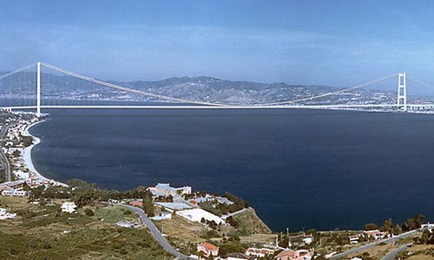  
Die **Brücke von Messina** (Kalabrien-Sizilien): 3.7km lang, 60m breit, Kosten 4 bis 8.5 Mia €.   
Projektbeginn 2003.   
Baubeginn 2007.   
Geplantes Projektende 2016.  
Stopp 2013 aus ökonomischen, ökologischen und "mafiösen" Gründen.

**Change-Management**: *Unter der* Regierung [Mario Monti](https://de.wikipedia.org/wiki/Mario_Monti) *wurden Rückstellungen in Höhe von 300 Millionen Euro* **für Nachverhandlungen** *gebildet, nachdem der Generalunternehmer Eurolink vom Werkvertrag zurückgetreten war.*

*Da der Zusatzvertrag am 1. März 2013 nicht unterzeichnet war,* **wurde das Vertragswerk** *zwischen Eurolink und Stretto di Messina S.p.A.* **ungültig***; die* **Auflösung der Betreibergesellschaft** *wurde eingeleitet. (Quelle* [*https://de.wikipedia.org/wiki/Br%C3%BCcke_%C3%BCber_die_Stra%C3%9Fe_von_Messina*](https://de.wikipedia.org/wiki/Br%C3%BCcke_%C3%BCber_die_Stra%C3%9Fe_von_Messina)*)*

### Change Management

Der Fachbegriff für das Behandeln von Änderungen (durch einen **Änderungsantrag**) während eines Projektes heisst „Change Management“.

Das Verfahren oder der Prozess muss in der Baseline festgelegt werden. Festzulegen ist:

-   Dass keiner der Beteiligten von sich aus einseitig den Projektumfang verändern darf, z.B. stillschweigend Funktionalität „streichen“, die ausgemacht wurde.
-   Dass der Auftraggeber Änderungswünsche **nur über den Projektleiter** anbringen kann.
-   Dass Projektmitarbeiter nicht ohne Genehmigung des Projektleiters zusätzliche (oder weniger) Funktionalität erstellen darf, selbst wenn die Anweisung vom Auftraggeber stammt.
-   Dass jede Änderung dokumentiert wird
-   Dass jede Änderung eine Kostenfolge nach sich zieht oder ziehen kann, die der Auftraggeber übernehmen muss.

## Der Projektstart

Weil der Projektleiter schliesslich für den Erfolg des Projektes geradestehen muss, sollte er oder sie möglichst früh involviert werden. Nicht in jedem Unternehmen wird dies berücksichtigt und gerade dies führt zu den meisten Konflikten beim Projektstart, weil z.B. der Verkäufer dem Kunden ein Resultat zu Bedingungen verspricht, die der Projektleiter niemals einhalten kann.

*In der Informatikbranche, besonders in der Softwareentwicklung, haben die meisten Projekte einen hohen Innovationsgrad. Software wird meistens deshalb entwickelt und eingeführt, weil sich ein Unternehmen einen Wettbewerbsvorteil davon verspricht. Mit der Einführung von Onlinebanking über Computer verlagerten die Banken aufwendige und kostenintensive Datenerfassungsarbeiten zu den eigenen Kunden. Bei einem hohen Innovationsgrad ist das Risiko mit Aufwandschätzungen danebenzuliegen entsprechend hoch. Um das Risiko von Informatikprojekten zu minimieren, werden – oder sollten – beim Projektstart zwei Phasen durchlaufen:*

| Beschreibung der Phase                                                                                                                                                                      | Kenntnis des Projektumfanges                                                                                                                                                                                            | Ergebnis                                                                                                                                                                                                                                        |
|---------------------------------------------------------------------------------------------------------------------------------------------------------------------------------------------|-------------------------------------------------------------------------------------------------------------------------------------------------------------------------------------------------------------------------|-------------------------------------------------------------------------------------------------------------------------------------------------------------------------------------------------------------------------------------------------|
| Formelle Phasenbezeichnung: **Projektanstoss**   Formulierung des Problems durch Auftraggeber, meistens im Gespräch mit Verkäufer oder durch Zusendung eines „Request for Information“.     | Hängt davon ab, wie intensiv die Ziele diskutiert werden, vom Innovationsgrad und der Kenntnis der Beteiligten über das Projektumfeld – in der Regel eher tief                                                          | **Grober Lösungsentwurf** in Form einer Grob-Offerte, eines Projektantrags, eines Pflichtenheftes, grobe Aufwandschätzung. Auf der Basis des Projektantrages erfolgt der Entscheid, ob ein Projekt weiterverfolgt werden soll.  *Kosten: 0.- €* |
| Formelle Phasenbezeichnung: **Vorstudie**   Genauere Analyse und Formulierung des Problemfeldes. Eventuell dient ein vom Kunden erstelltes Pflichtenheft als Basis („Request for Proposal“) | Die Details werden ausgearbeitet. Zu diesem Zeitpunkt kennt man das Projektumfeld bedeutend besser. Die ersten Risiken werden offensichtlich. Wenn man Pech hat stellt man fest, dass man mit der Vorphase danebenlag.  | **Konkreter Lösungsentwurf**, mit detaillierten Aussagen über Aufwand, Ressourcen, Projektorganisation, etc. Das Schlussdokument (Vertrag, Auftrag, Projektauftrag) ist in der Regel „unterschriftsreif“.  *Kosten: Fixer Betrag*               |
| Eigentliche **Projektphasen** ...                                                                                                                                                           | z.B. IPERKA ...                                                                                                                                                                                                         |                                                                                                                                                                                                                                                 |

### Typische Aufgaben des Projektleiters beim Projektstart

| **Projektanstoss** | Teilnahme an der Zieldefinition (mit Auftraggeber) Erarbeiten von groben Lösungsvorschlägen Grobschätzung des Aufwands Formulierung des Projektantrages (ganz oder teilweise)                                                                                                 |
|--------------------|-------------------------------------------------------------------------------------------------------------------------------------------------------------------------------------------------------------------------------------------------------------------------------|
| **Vorstudie**      | Leitung und Qualitätssicherung der Phase  Organisation der Ressourcen zur Lösungsanalyse Bestimmung des Aufwands und der Ressourcen Planung des Projektes Formulierung des **Projektauftrags** (ganz oder teilweise) Präsentation der Ergebnisse vor dem Entscheidungsgremium |

## Der Projektauftrag (Teil der Baseline)

Folgende Punkte sind in einem Projektauftrag mindestens festzuhalten: (Checkliste)

-   Auftraggeber (muss Entscheidungsbefugnis haben!)
-   Auftragnehmer / Projektleiter
-   Projektziele
-   Zu erarbeitende Lieferungen und Leistungen
-   Erwartete Qualität der Ergebnisse
-   Erwartete und bestätigte Termine
-   Erwartete und bestätigte Kosten
-   Finanzierung / Verrechnung
-   Art und Durchführung der Abnahme / Kontrolle

    Ergänzend (gemäss Systems Engineering, Projektmethode für EDV-Projekte):

    **Ausganglage, Ist-Zustand**: Kurzbeschreibung des Problems bzw. der Startsituation sowie Begründung, warum dieses Projekt überhaupt angegangen werden soll.

    **Zielsetzung, Soll-Zustand**: Welchen Nutzen man von einer Lösung erwartet, wo dieser eintreffen soll und welcher Art dieser Nutzen ist.

    **Projektablaufziele**: Welche Art von Entscheidung am Ende einer Phase zu treffen sind und welche Ergebnisse in jeder Phase zu erarbeiten sind.   
    (Siehe auch Vorgehensmodelle)

    **Projektabgrenzung**: Beschreibung des Untersuchungs- und Gestaltungsbereiches (bzw., mit welchen Organisationseinheiten man sich ausschliesslich beschäftigt“). Und ganz wichtig – mit allem andern beschäftigt man sich nicht!

    **Randbedingungen**: Auflagen, die zu beachten sind (gesetzliche, bautechnische, etc.)

    **Projektleiter** und ev. Projektgruppe: Name der Beteiligten

    **Umfang des erwarteten Arbeitseinsatzes:**

-   Termine: Starttermin, Zwischentermine (= Meilensteine), Abschlusstermin
-   Aufwand: In Arbeitstagen und/oder Geldbeträgen
-   Projektorganisation: „Hierarchische“ Übersicht und Zusammensetzung des Projektausschusses
-   Ergebnisse: Art und Form der Liefereinheiten
-   Sonstiges: Notwendige Voraussetzungen für eine erfolgreiche Abwicklung

# Organisation

Im ersten Teil beschäftigen wir uns um die Unternehmensorganisation:

-   Kennen möglicher Organisationsformen eines Unternehmens, sowie deren Vor- und Nachteile.
-   Schnelles Zurechtfinden in einer neuen Organisation
-   Fähigkeit ein korrektes Organigramm einer Firma zu zeichnen und zu erklären
-   Erkennen und Erklären von Dienstwegen

Der zweite Teil beschäftigt wir uns mit der Projektorganisation:

-   Wie Projekte organisiert werden können

## **Unternehmensorganisation und ihre Dienstwege**

Dienstwege sind organisatorische Strukturen von der Unternehmensspritze über die verschiedenen Instanzen bis ins letzte Glied. Dadurch entstehen Zwischenstufen, die durch eine Linie verbunden sind. Diese Linien stellen den Dienstweg, oder auch Instanzenweg dar.

Als Grundsatz gilt, dass normalerweise der Dienstweg eingehalten werden muss. Dadurch wird eine einheitliche Leitung und die Koordination der Aufgaben gewährleistet.

Normalerweise bedeutet das, dass alle Richtlinien, Anordnungen, Informationen usw., also alle Gegebenheiten von wichtiger Bedeutung über den Dienstweg laufen.

Da der Instanzenweg manchmal lang ist und unter Umständen die Geschäftsabwicklung erschweren kann, könne auch Ausnahmen vorgesehen werden.

-   Z.B. bei dringlichen Entscheiden, wobei nachträglich die übersprungene Instanz informiert werden muss.

Innerhalb der Dienstwege können auch Querverbindungen aufgebaut sein. Auf diesen Kanälen können Informationen (z.B. bei Routineangelegenheiten) ausgetauscht werden, ohne den ordentlichen Dienstweg beanspruchen zu müssen.

**Deshalb ist es wichtig, dass bei der Organisation der Dienstwege jeder Mitarbeiter weiss:**

-   welche Instanz ihm unterstellt oder übergeordnet ist
-   wie der Dienstweg aufgebaut ist
-   wann er eine Angelegenheit zum Entscheid unterbreiten muss
-   wann er selbst einen Entscheid treffen kann
-   auf welchen Gebieten er Anweisungen anderer Abteilungen zu beachten hat
-   wann er vom Dienstweg abweichen kann

### Die Linien-Organisation

Der Inhaber einer Linienstelle muss von Vorgesetzten Befehle entgegennehmen (zur Befolgung verpflichtet) und darf seinerseits untergeordneten Instanzen Weisungen erteilen (weisungsberechtigt). Vorgesetzter und Untergebener sind durch eine Linie verbunden, die den Dienstweg darstellt, an den sich alle halten müssen.

a) Grundsatz:

-   Einheit der Leitung
-   Einheit des Auftragsempfängers

b) Eigenheiten

-   Die Linie gilt als Dienstweg für Anordnungen, Kommunikation, Beschwerde und Information.
-   Die Linie muss als Delegationsweg angesehen werden.
-   Hierarchisches Denken
-   Keine Spezialisierung bei der Leitungsfunktion
-   Praxis a) Tendenz zur Bildung von Abteilungsdenken  
     b) Tendenz zur Angliederung von Stäben und Komitees

c) Schema:

d) Vorteile

-   klare Kompetenz- und Verantwortungsbereiche
-   klare Anordnungen
-   Koordination und Kontrolle einfach
-   Sicherheit bei Vorgesetzten und Untergebenen
-   tüchtige Linienchefs werden gefördert

e) Nachteile

-   Unvereinbarkeit mit dem Grundsatz der Spezialisierung
-   Schwerfälligkeit, Bürokratisierung
-   Unterdimensionierte Kommunikationsstruktur
-   Betonung der Hierarchie
-   Überlastung der Leitungsspitze
-   Starrheit
-   Lange Kommunikationswege ergeben Informationszerfall (Filtrierung)
-   Belastung der Zwischeninstanzen
-   Unvereinbarkeit mit zeitgemässen menschlichen Anforderungen

### ** **Die Stab-Linien-Organisation

Der Inhaber einer Stabsstelle bearbeitet im Auftrag von Linienstellen-Inhabern bestimmte Probleme, arbeitet Vorschläge aus und berät den Auftraggeber. Der Inhaber einer Stabsstelle hat keine Weisungsbefugnisse. Er erfüllt in erster Linie eine beratende Tätigkeit und dient zur Entlastung der Linienstellen. Stabsstellen werden oft für Spezialaufgaben geschaffen. Zum Beispiel Rechtsabteilung, Personalabteilung, Steuerabteilung oder einfach für ein(e) SekretärIn, ExperteIn, PraktikantIn.

a) Grundsatz:

-   Einheit der Leitung
-   Spezialisierung von Stäben mit Leitungshilfefunktionen ohne Kompetenzen   
    gegenüber der Linie

b) Eigenheiten

-   Entscheidungskompetenz von Fachkompetenz getrennt
-   Systematische Entscheidungsvorbereitung
-   Praxis a) Tendenz zur Bildung einer eigentlichen funktionalen Stabshierarchie  
     b) Tendenz zu zentralen Dienststellen (unechte Funktionalisierung)

c) Schema:

d) Vorteile

-   Einheit der Leitung trotz gewisser Spezialisierung
-   Entlastung der Linieninstanzen
-   fachkundige Entscheidungsvorbereitung
-   Ausgleich zwischen Spezialistendenken und übergeordneten Zusammenhängen

e) Nachteile

-   Stab als „Alternative“ zur richtigen Organisation
-   Bildung von „Wasserköpfen“ in der obersten Stufe
-   Stab als Vorwand für mangelnde Delegation
-   Stab als „graue Eminenz“ (Macht ohne Verantwortung)
-   Stab als Konkurrenz zur Linienorganisation

### Die funktionale Organisation, Mehrliniensystem

Im **Mehrliniensystem** herrscht eine Mehrfachunterstellung und es gilt das Prinzip der kürzesten Wege.

Das bedeutet, dass jeder Mitarbeiter mehrere Vorgesetzte hat und jeder Vorgesetzte jeden Mitarbeiter in einem bestimmten Aufgabenbereich delegieren kann.

Man nennt das Mehrliniensystem daher auch **„Funktionale Organisation“**, da es hier für bestimmte Funktionen spezialisierte Vorgesetzte gibt, welche nur für ihren Funktionsbereich Aufgaben erteilen. Wenn sich für die Aufgabenerfüllung eines Mitarbeiters verschiedene Funktionen überschneiden, so erhält er auch von mehreren Vorgesetzten Anweisungen.

a) Grundsatz:

-   Spezialisierung
-   Direkter Weg
-   Mehrfachunterstellung

b) Eigenheiten

-   Übereinstimmung von Fachkompetenzen und Entscheidungskompetenzen
-   Funktionale Spezialisierung der Leitungsorgane
-   Praxis: Tendenz zur unechten Funktionalisierung (nur funktionelle Dienststellen,  
     wie z.B. Personalwesen)

c) Schema

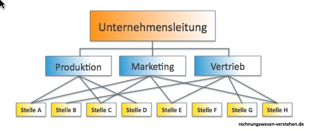

d) Vorteile

-   fachkundige Entscheidungen
-   Entbürokratisierung
-   Fachkompetenzen wichtiger als hierarchische Stellung
-   grössere Leitungskapazität
-   kurze Kommunikationswege
-   psychologischer Vorteil der funktionalen Autorität

e) Nachteile

-   Kompetenzüberschreitungen kaum vermeidbar
-   Unsicherheit bei Vorgesetzten und Untergebenen
-   komplizierte Kommunikationsstruktur, schwierige Koordination und Kontrolle
-   fehlender Überblick über das Ganze ergibt beim Spezialisten Ressort-Denken
-   Überbewertung der eigenen Aufgaben

### Die Matrix-Organisation

Bei der **Matrixorganisation** werden die nach Funktionen gegliederten vertikalen Linien von projekt- oder produktorientierten horizontalen Linien überlagert. Es entstehen dadurch Schnittstellen, welche von einem Mitarbeiter oder von Teams besetzt werden können.

a) Grundsatz:

-   Spezialisierung nach Dimensionen
-   Gleichberechtigung der Dimensionen

b) Eigenheiten

-   Perfektionierte Form der funktionalen Organisation
-   Systematische Regelung der Kompetenzenkreuzungen
-   Teamarbeit der Dimensionsleiter
-   Praxis: Tendenz zur Gewichtung eines Dimensionsleiters als „Primus inter Pares“  
     (Erster unter Gleichen)

c) Schema

d) Vorteile:

-   sachgerechte Teamentscheidungen
-   übersichtliche Koordination
-   institutionalisierter Konflikt zwischen Dimensionen
-   psychologischer Vorteil der funktionalen Autorität

e) Nachteile:

-   Kompetenzabgrenzungen aufwendig
-   grosser Kommunikationsbedarf
-   kaum nachvollziehbare Entscheidungsprozesse
-   Gefahr zu viele Kompromisse
-   wenig Alleinverantwortung für Dimensionsleiter

## Projektorganisation

Eine Projektorganisation bildet in der Regel **eine Organisation innerhalb der Organisation** dar. Manchmal hat das zur Folge, dass Hierarchiestufen „durcheinandergeraten“ und bieten somit viel Reibungsfläche und Raum für „Politisches“.

Eines ist sicher: Ohne die Unterstützung des Auftraggebers hat der Projektleiter gegenüber dem Projektteam einen schweren Stand. Und wenn der Projektleiter nicht führen kann oder will, weil er sich zum Beispiel bei seinen Arbeitskollegen nicht unbeliebt machen will, dann ist das Projekt von Anfang an in Gefahr.

Für eine ideale Projektorganisation sollten diese Punkte berücksichtigt werden[^1]:

[^1]: Jenny, Projektmanagement in der Wirtschaftsinformatik

-   Frühzeitige Information der möglichen, gewünschten Mitarbeiter
-   Gezielte Vorbereitung der Mitarbeiter (z. B. Ausbildung)
-   Klare Abmachungen mit dem Linienvorgesetzten
-   Genaue Darstellung der erwarteten Leistung
-   Definition von Sondervollmachten, speziell des Projektleiters (Unterschriftsrecht, Aufhebung Blockzeiten, etc.)
-   Darlegen der Erfolgsaussichten
-   Aufzeigen der möglichen Risiken

    Die **Grundformen** der Projektorganisation sind: reine Projektorganisation, Matrix-Projektorganisation und Stab-Linien Projektorganisation. Die Entscheidung für eine der Organisationsformen hängt vom der Projektgrösse und –art ab, und auch, was im Unternehmen üblich und machbar ist.

### Reine Projektorganisation

Bei dieser Organisationsform werden alle Projektmitarbeiter voll dem Projekt zugeteilt und aus ihrer bisherigen Organisationseinheiten gelöst. Für die Dauer des Projektes ist der Projektleiter der Vorgesetzte mit allen disziplinarischen Konsequenzen (Ferienregelung, Leistungsbeurteilung, etc.)

**Vorteil**:

Die Mitarbeiter konzentrieren sich voll auf das Projekt. Das kann zu Leistungssteigerung führen und ist in der Regel konfliktarm.

**Nachteil**:

Die Teammitglieder müssen aus der Firmenhierarchie aus- und wieder eingegliedert werden.

### Matrix-Projektorganisation

Bei der Matrix-Organisation entsteht für die Dauer des Projektes ein zeitlich befristetes Mehrlinien-System. Dieses wird meist als Matrix dargestellt.

**Vorteil**:

Geringe Umstellungskosten

**Nachteil**:

Der Mitarbeiter hat zwei Vorgesetzte, denen er gerecht werden muss.

### Stab-Linien-Projektorganisation

Bei dieser Organisationsform wird dem Projektleiter die Leitung in Form einer „Koordinationsaufgabe“ übertragen, ohne ihm formale Weisungsrechte zu gewähren.

**Vorteil:**

Keine organisatorische Umstellung der Firmenorganisation

**Nachteil:**

Aufgrund der Dezentralisierung der Verantwortlichkeiten vergrössert sich das Projektrisiko

# Die Rolle des Projektleiters und Projektleitung

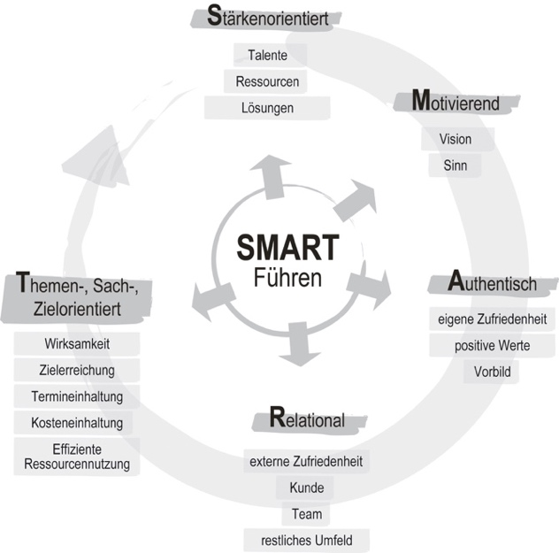Als **Projektverantwortlicher** sollten Sie

-   Freude an Verantwortung (nicht an Risiken)
-   Freude bei der Koordination (nicht bei der Arbeit)

    haben, als **Vorgesetzter** sollten Sie

-   natürliche Autorität,
-   Fähigkeit zur Motivation

    haben oder als **Sachbearbeiter**

-   gute Auffassungsgabe, (keine extreme Sachkenntnis)

    Der Projektleiter muss in mehreren fachlichen und menschlichen Aspekten überzeugen. Er ist nicht nur Sachbearbeiter, sondern hat Verantwortung gegenüber seinen Mitarbeitern und gegenüber der Firma und gegenüber den Stakeholdern.

    Zunächst muss der Projektleiter gewillt sein, Verantwortung zu übernehmen. Er muss koordinieren können und für optimale Arbeitsvoraussetzungen sorgen. Als Arbeitskraft ist er nicht gefragt. Die Arbeit am Detail verhindert die Sicht auf die Gesamtzusammenhänge.

    Als Vorgesetzter muss er in der Lage sein, seine Anweisungen durchzusetzen. Hier ist nicht an die Gefahr einer Arbeitsverweigerung gedacht (die gibt es nur sehr selten), sondern an die Fähigkeit zu höchster Leistung zu motivieren. Dies wird nur erreicht, wenn die Mitarbeiter gern und gut arbeiten.

    Als Sachbearbeiter muss er nicht durch Kenntnisse brillieren, sondern durch rasche Auffassungsgabe. Er muss schnell einen Überblick über die Zusammenhänge bekommen, um dann Details delegieren zu können.

    Hat der Projektleiter zu wenig von dem Problem verstanden, wird er seine Sachbearbeiter in die falsche Richtung schicken und somit deren effizienten Einsatz gefährden.

    Nachfolgend eine weitere Definition, wie sie in der einschlägigen Literatur zu finden ist.

Von der Aufzählung, was er/sie tun sollte, lassen sich die wichtigsten Kompetenzen ableiten:

-   Zugriff auf alle projektrelevanten Daten (Budgets, Stundensätze, Mitarbeiterdaten zu Erfahrung und Ausbildung)
-   Weisungs- und Kontrollbefugnis gegenüber Projektmitarbeiter und Lieferanten – und zwar auf direktem Weg
-   Unterschriftsbefugnis im Rahmen des Projektes
-   Befugnis, im Rahmen des Projektes Ressourcen zu mobilisieren, Spesen zu bewilligen, etc.
-   Die Kompetenz, über die Verrechnung von Ressourcen zu entscheiden

    Daraus ergeben sich die Fähigkeiten, die es zu einem erfolgreichen Projektleiter braucht.

| **Fähigkeiten**          | **Kompetenzen**                                                                                                                                                                                            |
|--------------------------|------------------------------------------------------------------------------------------------------------------------------------------------------------------------------------------------------------|
| Leadership               | Richtung weisen Ziele definieren Team auf Ziel ausrichten Delegieren Entscheidungen treffen                                                                                                                |
| Fachkenntnisse           | Die benutze Technologie verstehen Technologiemanagement  Mit den Technikern kommunizieren Bei der Problemlösung assistieren                                                                                |
| Human Skills             | Teambildung Motivation Konfliktlösung Auf allen Stufen kommunizieren können Team-Geist pflegen                                                                                                             |
| Administratives          | Offerten und Projektplanung erstellen Verhandeln über Ressourcen (Preise, Mengen) Prozeduren konzeptionell bestimmen und aufsetzen Projektkontrollsystem einführen und unterhalten Personaleinsätze planen |
| Organisation             | Multifunktionale Teams aufbauen Mit dem Management zusammenarbeiten Organisationsstrukturen und -schnittstellen verstehen Effiziente Projektorganisation aufbauen                                          |
| Unternehmerisches Denken |  Erreichen der betriebswirtschaftlichen Ziele Neue Unternehmenszweige eröffnen                                                                                                                             |

Aber zum Erfolg trägt natürlich nicht nur der Projektleiter bei, sondern alle Beteiligten, mit anderen Worten Projektarbeit ist Arbeiten im Team.

## Teambildung

Dabei spielt zu Beginn die Bildung eines Teams eine entscheidende Rolle. Durch Studien wurde herausgefunden, dass sich der Teambildungs-Prozess nach festen Regeln abspielt. Diese werden wie folgt benannt.

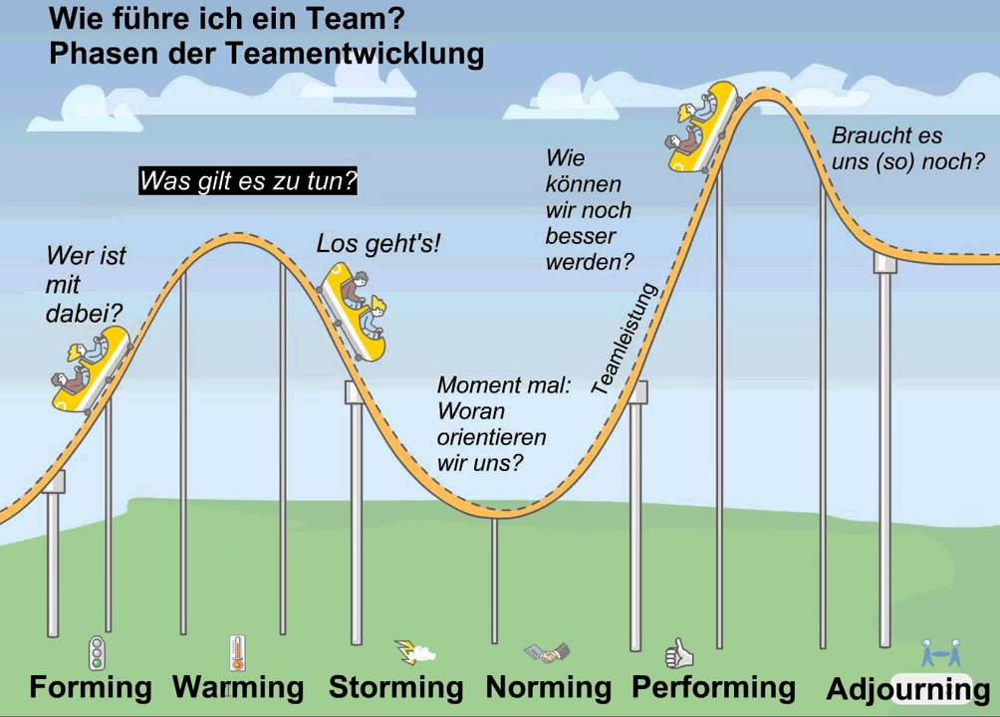

| **Forming** *  (+Warming)* | In der ersten Phase der Gruppenentwicklung werden Fronten, Untergruppen und Unterführer gebildet. Alle Gruppenmitglieder sind ängstlich und haltlos, da sich noch keine festen Strukturen gebildet haben. Die Tendenz der Gruppenmitglieder sich an 'hervortretende Gruppenmitglieder' anzuschliessen, ist gross. |
|----------------------------|-------------------------------------------------------------------------------------------------------------------------------------------------------------------------------------------------------------------------------------------------------------------------------------------------------------------|
| **Storming**               | Nach der ängstlichen Phase treten vor dem Übergang in die Normierungsphase Machtgefechte auf. Manchmal haben zwei Unterführer in der Formierungsphase die Leitung von Teilgruppen übernommen oder es entsteht ein Machtkampf zwischen einem schwachen Projektleiter und einem starken Gruppenmitglied.            |
| **Norming**                | Danach kommt eine Phase der Normierung. Die Machtverhältnisse sind klar, die Trägheit siegt über die Kampflust. Verhaltensweisen spielen sich ein.                                                                                                                                                                |
| **Performing**             | Die Energie ist jetzt für die eigentliche Arbeit verfügbar.                                                                                                                                                                                                                                                       |
| **Adjourning**             | Die (Projekt-)Gruppe löst sich (organisiert) wieder auf (und kehrt z.B. wieder an den alten Arbeitsplatz zurück).                                                                                                                                                                                                 |

Gruppen haben gegenüber der Einzelarbeit Vor und Nachteile. Aufgabe des Projektleiters ist es, alle Aktivitäten in der Gruppe so zu lenken, dass die Vorteile genutzt werden, die Nachteile aber in vertretbaren Grenzen bleiben.

Vorteile bei der Gruppenarbeit sind die Masse an Wissen, die sich über die Mitarbeiter addiert. Oft muss eine Einzelperson lange an einem Problem arbeiten, das ein anderer schon gelöst hat. Damit das funktioniert, muss Person A fragen und Person B antworten. Beides ist nicht selbstverständlich! Person A kann das Gefühl haben, dass das eine dumme Frage ist. Vielleicht traut er sich einfach nicht, in der grossen Gruppe zu sprechen. Person B muss bereit sein, seinen Vorteil zu teilen. Er könnte sich auch blamieren, wenn seine Antwort doch nicht richtig ist.

Wie verhält der Projektleiter sich nun in den Teamphasen optimal?

| **Forming**    | Hier hat der Projektleiter die Chance, die Leitung zu übernehmen. Bildet sich hier ein Unter- oder Gegengruppenführer, wird der Projektleiter es schwer haben, seine Autorität zurückzuerlangen. |
|----------------|--------------------------------------------------------------------------------------------------------------------------------------------------------------------------------------------------|
| **Storming**   | Dies ist die letzte Möglichkeit des Projektleiters, seine Autorität zu zeigen. Dies sollte er mit einer natürlichen Authentizität tun und seine Leitungsrolle festigen.                          |
| **Norming**    | Der Projektleiter gibt nun die Struktur vor und wird zum "Coach".                                                                                                                                |
| **Performing** | Der Projektleiterkann seine Aufgaben delegieren.                                                                                                                                                 |
| **Adjourning** | Der Projektleiter behält die Verantwortung bis jedes Teammitglied "übergeben" wurde.                                                                                                             |

In offenen Diskussionen können Synergien auftreten, die weit über die Summe des Wissens hinausgehen. Durch verblüffende Querfragen können Wege geöffnet werden, an die der Experte all eine nie denken würde. Die Gruppe kann Kreativität steigern.

Wissensaustausch, wie in Workshops beispielsweise, kann den Wissensfluss der Experten beschleunigen.

Nachteile sind hauptsächlich Blockierungen aus zwischenmenschlichen Gründen. Konkurrenzdenken kann destruktiv sein. Die Verbindung von Aufgaben mit verantwortlichen Personen fördert deren Motivation, führt aber bei Misserfolgen zu Problemen des Verantwortlichen. Die Angst davor kann dazu führen, dass sich Personen mit ihren Problemen abschotten. Die positiven Einflüsse der Gruppe werden neutralisiert.

## Soziales Faulenzen (social loafing)

Der Begriff Soziales Faulenzen (engl. **social loafing**) beschreibt ein sozialpsychologisch relevantes Phänomen in einer Gruppe. Sobald Individuen im Kollektiv mit anderen auf ein gemeinsames Ziel hinarbeiten und dabei ihre Einzelleistung nicht bekannt wird, reduziert sich ihre physiologische Anspannung. <https://de.wikipedia.org/wiki/Soziales_Faulenzen>

Zum Beispiel gibt es Soziales Faulenzen bei Ruderern, nicht aber bei Schwimmstaffeln, denn dort sind die Zeiten der einzelnen Schwimmer immer noch sichtbar.

   

## Effektive Sitzungen

Was sollten Sie zu Teambesprechungen wissen? Anhand gängiger Fragen finden Sie hier Infos, wofür Teammeetings sinnvoll sind, wie perfekte Teambesprechungen ablaufen, wie Sie sie planen können und vieles mehr. Schlechte Erfahrungen mit Teambesprechungen hat so ziemlich jeder schon gemacht. Insofern hat zum Glück auch jede Idee, was er anders machen würde und welche "Fallen" es zu vermeiden gilt. Dass wir dennoch ab und zu hineinfallen, sei verziehen - Hauptsache, wir verbessern uns!

**  
**

**Warum sind Teambesprechungen wichtig?**

Teambesprechungen sind ein wichtiges Steuerungselement in einem Unternehmen, da sie dafür sorgen, dass die Teams die Ziele nicht aus den Augen verlieren und Abstimmungsprozesse untereinander erfolgen können. Das Ziel einer Teambesprechung ist es also, dass die Maßnahmen, an denen die unterschiedlichen Mitarbeiter arbeiten, sauber und konfliktfrei ineinander greifen - im Rahmen einer Teamsitzung können Schnittstellen geklärt und Zeitpläne abgestimmt werden. Doch nicht nur für direkte Abstimmungsprozesse sind Teammeetings sinnvoll, sie können zudem genutzt werden, um kontinuierliche Verbesserungsprozesse am Laufen zu halten oder um neue Ideen und Produkte zu entwickeln. Zudem sind sie wichtig für die Teamkultur und das schnelle Ausräumen und Beseitigen von Missverständnissen, Konflikten und Gerüchten. Perfekte Teambesprechungen bringen also viele Vorteile!

### Was sind typische Fallen bei Teambesprechungen?

Manchmal haben Meetings die Tendenz aus dem Ruder zu laufen. Sie sind ineffizient, produzieren Kosten, Langeweile und Frustration. Hierfür kann es ganz verschiedene Gründe geben. Hier ein paar Beispiele:

-   Die Teamsitzung hat weder eine klare Zeit- noch Inhaltsstruktur.
-   Mitarbeiter wie Führungskräfte nutzen die Meetings als Bühne zur Selbstdarstellung.
-   Alles ist im Prinzip schon entschieden und wird nur scheinbar diskutiert.
-   Andere Meinungen und Ideen zählen nicht.
-   Es wird nur viel diskutiert, aber keine Entscheidungen getroffen.
-   Eine Visualisierung fehlt.
-   Die Dokumentation fehlt.
-   Es werden Entscheidungen getroffen, die nicht umgesetzt werden.
-   Mitarbeiter können beim Thema nicht mitreden.

Trifft einer der Punkte auf Ihre Meetings zu? Dann fangen Sie an, umzusteuern und die Besprechungskultur Ihrer Teambesprechungen und Meetings zu ändern! Sie werden schnell die Verbesserungen wahrnehmen.

### Tipps & Regeln für gute Teambesprechungen

Aus den beschriebenen "Fallen" und Beobachtungen ergeben sich folgende 10 Tipps und Regeln für effiziente Teammeetings, die Sie bei der Vorbereitung und Planung der Teambesprechung im Blick haben können:

1.  Führen Sie Ihre Teambesprechung regelmäßig zu vorher festgelegten Terminen durch, z.B. jeden zweiten Mittwoch um 10 Uhr. Dieser Termin hat gegenüber anderen Terminen Priorität! Geben Sie Ihrem Meeting zudem eine **klare Zeitbegrenzung**. Gerade bei Teamsitzungen in kurzen regelmäßigen Abständen reichen meist 30 - 60 Minuten aus. Wichtig: Beginnen Sie pünktlich – egal, ob alle da sind oder nicht, und enden Sie spätestens zur angegebenen Zeit!
2.  **Stimmen Sie vorher eine Agenda ab**, fertigen Sie eine Themenliste an und fordern Sie vorbereitete Mitarbeiter, die Ihnen schon vorher ihre Themen für die Teambesprechung einreichen.
3.  Auf der Teambesprechung werden die Punkte besprochen, **die alle Teilnehmenden angehen**. Ggf. teilen Sie das Meeting auf Themen und Teilnehmende auf!
4.  Grundsätzlich ist bei dem Traktandum „Sonstiges“ (dt. Tagesordnungspunkt - TOP, engl. Agenda) Vorsicht geboten. Im Punkt „Sonstiges“ sammeln sich häufig eine Vielzahl von Punkten und da sie vorab nicht bekannt sind, entziehen sie sich der Planbarkeit. So kommt es, dass dieser Tagungsordnungspunkt gerne mehr Zeit frisst, als alle anderen Punkte vorab. „Sonstiges“ ist zudem die Einladung für alle, die sich vorab keine Gedanken machen und dieses auch anderen nicht ermöglichen wollen. D.h. hier diskutieren dann alle nur aus dem „Bauch heraus“. Das kostet Zeit und führt häufig zu Fehlentscheidungen, die später überdacht werden müssen, und zu Stress.
5.  Durchaus vielversprechend: **Meetings im Stehen**, v. a. bei kurzen Meetings und schnellen Abstimmungsprozessen, können mehr Energie enthalten, sind durch den schnellen Austausch häufig dynamischer und dadurch ggfs. produktiver. Allerdings ist ein schneller Austausch nicht für jeden Mitarbeiter etwas: Bei schnellen Meetings fühlen sich v. a. die Proaktiven angesprochen, während die Reaktiven, die zunächst über das Gesagte nachdenken und es tiefer durchdringen wollen, weniger Möglichkeiten haben, sich einzubringen. Also gut abwägen und die Methode der Meetings im Stehen gezielt einsetzen bzw. bewusst ausprobieren. Was häufig Wunder wirkt: Längere Teambesprechungen in mehrere Phasen teilen, wovon eine (oder mehr) dann im Stehen stattfindet und für Bewegung und Perspektivwechsel sorgt.
6.  **Klare, strukturierte Moderation**. Dabei kann sowohl die Führungskraft wie einer der Teilnehmenden der Moderator sein. Wichtig ist, dass beide immer die garantierten Energiegeber für die Teambesprechung sind.
7.  Übrigens: Der Moderator regelt auch, dass persönliche, nicht sachbezogene Diskussionen an einer anderen Stelle und nicht im Teammeeting stattfinden! Dies ist eine wichtige Regel für Teambesprechungen. Ggf. moderiert er diese Diskussion dann auch.
8.  **Visualisierung** der Tagesordnung und Dokumentation der Ergebnisse in Form eines Protokolls. Die Visualisierung sorgt für Orientierung/Sicherheit und die **Dokumentation der Ergebnisse** schützt vor „Vergesslichkeit“, schafft Transparenz und ermöglicht eine gute Ergebniskontrolle.
9.  Lebende Besprechungsregeln festlegen. **Besprechungsregeln, also Regeln der Teamsitzung,** sind notwendig. Nicht immer müssen sie jedoch von der Führungskraft als „Verwaltungsakt“ vorgegeben werden. Und in manchen Gruppen sind Regeln wie „nicht dazwischenreden“ eh selbstverständlich. Hilfreich ist ein Plakat, auf dem jeder Teilnehmende Regeln für die Besprechung dann notieren kann, wenn sie anfallen. "Lebend" heißt dabei: Es kann immer wieder etwas notiert oder auch gestrichen werden (weil es inzwischen gelebt wird).
10. **Aktivierende Fragen nutzen**, statt Agenda-Punkte abarbeiten oder Vorschläge referieren. Wenn Sie fragen „wie können wir X lösen“ oder „was können wir tun um Y zu vermeiden“, erreichen Sie bei den Teilnehmenden der Teambesprechung Beteiligung und Interesse.
11. Regelmäßig überprüfen, ob die Teambesprechung in dieser Form noch zielführend ist und ggf. ändern! Routinen sind nicht immer sinnvoll und manchmal sogar kontraproduktiv. Daher bei sich selbst und bei den Teilnehmenden regelmäßig prüfen, ob das Ziel des Meetings noch erreicht wird oder ob es ein Treffen um des Treffens Willen geworden ist.

    (Quelle: https://www.coniunctum.de/)

### Checkliste zur Sitzungsvorbereitung

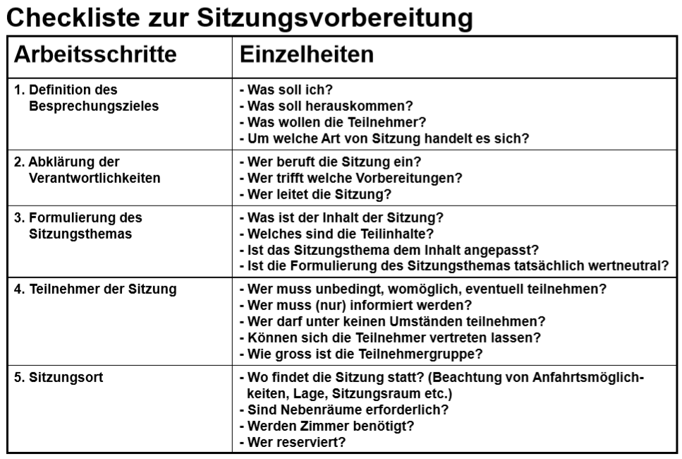

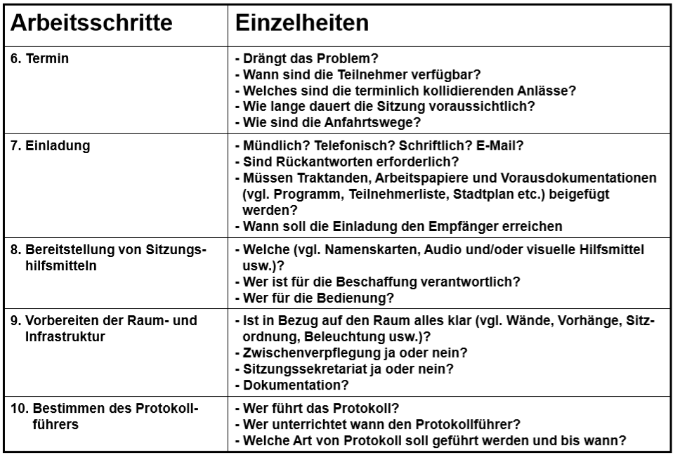

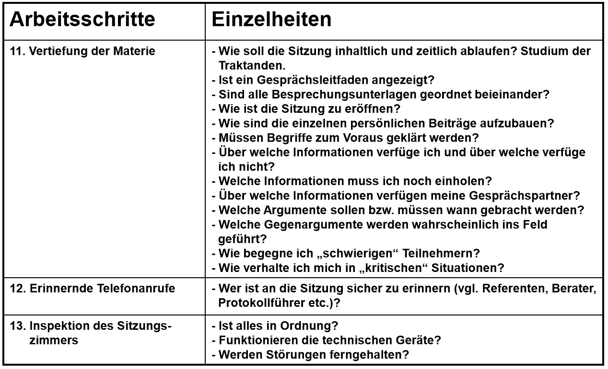

Quelle: <https://www.fravi-training.ch/media/downloads/pdf/Dokumentationen/Dokumentation_Sitzungsleitung_und_Protokollfuehrung.pdf>

### Sitzungstypen

Die Ineffektivität von Gruppen bei demokratischen Entscheidungen ist deren Hauptproblem. Zwischenmenschliche Prozesse fördern manchmal Diskussionen, die aus technischer Sicht keine Fortschritte mehr bringen. Entscheidungen werden 'tot -diskutiert'.

Für den Projektleiter ist die Kenntnis verschiedener Diskussionstypen hilfreich:

| **Die streitsüchtige Bulldogge...** | widerspricht auf aggressive Art und gefällt sich im destruktiven Kritisieren.                     |
|-------------------------------------|---------------------------------------------------------------------------------------------------|
| **Das positive Pferd...**           | ist sanftmütig und selbstsicher, geht zügig und direkt auf das Ziel los.                          |
| **Der allwissende Affe...**         | weiss alles besser und unterbricht stets mit Einwänden, Behauptungen und Zitaten.                 |
| **Der redselige Frosch...**         | redet, redet, redet um des Redens willen.                                                         |
| **Das schüchterne Reh...**          | schweigt am liebsten und enthält sich der Meinung.                                                |
| **Der ablehnende Igel...**          | macht auf Opposition, weist alles zurück und will sich nicht in die Diskussionsrunde integrieren. |
| **Das träge Flusspferd...**         | ist uninteressiert, wortkarg und gelangweilt, sitzt einfach da.                                   |
| **Die erhabene Giraffe...**         | ist überheblich, eingebildet, dominierend und sehr empfindlich auf Kritik.                        |
| **Der schlaue Fuchs...**            | wartet nur darauf, Sie bei der ersten Gelegenheit hinterrücks hereinzulegen.                      |

Wie verhält der Projektleiter sich nun gegenüber den beschriebenen Typen optimal?

| **Der Streitsüchtige** | Sachlich und ruhig bleiben, Streitgespräche vermeiden. Ihn zu einem konstruktiven Beitrag motivieren.                                                                                                                                |
|------------------------|--------------------------------------------------------------------------------------------------------------------------------------------------------------------------------------------------------------------------------------|
| **Der Positive**       | Ihn bewusst in die Diskussion mit einbeziehen, indem er zum Beispiel gebeten wird, zu einem strittigen Punkt Stellung zu nehmen.                                                                                                     |
| **Der Allwissende**    | Nie direkt auf seine Rede eingehen, er weiss es immer besser. Geschlossene Fragen stellen, die nur mit einem Wort (zum Beispiel "ja", "nein" oder "vielleicht") beantwortet werden können.                                           |
| **Der Redselige**      | Ihn taktvoll unterbrechen. Redezeiten festlegen. Geschlossene Fragen stellen (s. unter "Der Allwi ssende")                                                                                                                           |
| **Der Schüchterne**    | Sein Selbstvertrauen stärken, indem er Erfolgserlebnisse hat. Leichte, direkte Fragen stellen. Seine Antworten loben und seine richtigen Erkenntnisse an passender Stelle nochmals unter Namensnennung einfügen.                     |
| **Der Ablehnende**     | Nicht krampfhaft versuchen, ihn umzustimmen bzw. zu beteiligen. Geduld haben. Ihn von seinen Erfahrungen berichten lassen. Seine Erkenntnisse und Erfahrungen anerkennen. Ehrgeiz wecken.                                            |
| **Der Träge**          | Direkt nach seiner Meinung fragen. Ihm Erfolgserlebnisse geben. Ihn dazu motivieren, dass er seine Erfahrungen einbringt.                                                                                                            |
| **Der Erhabene**       | Keine offenen Fragen (zum Beispiel: "Was meinen Sie dazu?") stellen, sondern geschlossene. Die Ja-aber-Technik benutzen, zum Beispiel: "Sie haben völlig recht, allerdings ..." oder "Natürlich richtig, nur bedenken Sie, dass ..." |
| **Der Schlaue**        | Ruhig bleiben, konzentriert zuhören. Ihm unter Umständen andeuten, dass sein Verhalten auch Grenzen hat. Möglichst wenig direkte Antworten geben. Seine Fragen zur Stellungnahme an die Gruppe weitergeben.                          |

## 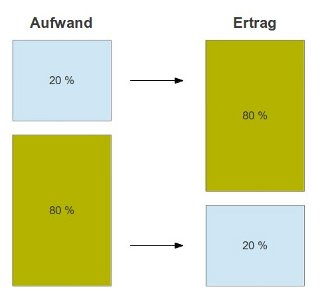Das Pareto-Prinzip, bzw. 80/20-Regel

Die 80/20 Regel besagt, dass er in 20% der Zeit 80% des Sachverhaltes erfassen soll. Die restlichen 20% des Problems werden dann durch Sachbearbeiter, also Spezialisten erarbeitet. Die **Detailarbeit** braucht in der Praxis dann die restlichen 80% der Gesamtzeit.

**Wenn wir das als Projektleiter wissen, können wir Anforderungen nur zu 80% erfüllen (=Ertrag) und so 80% des Aufwandes sparen!**

Wer das Pareto Prinzip im Zeitmanagement anwenden möchte, muss lernen, Prioritäten zu setzen.

**Beispiel Präsentationserstellung:**

Erfahrungsgemäß lassen sich Inhalte sehr schnell in eine Präsentation einfügen, anschließend verbrauchen die meisten Menschen aber viel Zeit damit, die Präsentation zu formatieren. Auf der Suche nach der immer perfekteren Form vergehen Stunden um Stunden.

Tatsächlich ist es aber so, dass schon nach zwanzig Prozent der Zeit, die Sie üblicherweise für die Formatierung benötigen, die Präsentation schon zu achtzig Prozent gut aussieht. Für die letzten zwanzig Prozent, die noch zum Optimum fehlen, verbrauchen Sie aber anschließend noch einmal vier mal so viel Zeit.

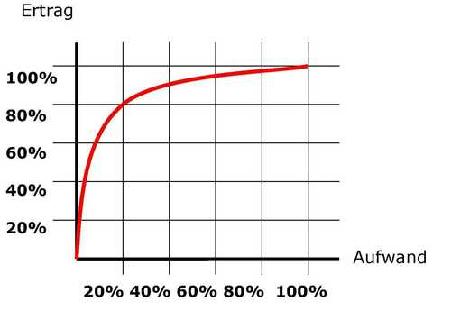Das Pareto Prinzip lehrt uns, Prioritäten zu setzen. Die Inhalte einer Präsentation sind viel wichtiger als ihre Form. Es genügt bereits, wenn die Form schon zu achtzig Prozent stimmt. Die letzten zwanzig Prozent bemerken sowieso nur sie selbst. Wenn sie es also bei achtzig Prozent gut sein lassen, können viel Zeit sparen, um sich wichtigeren Aufgaben zu widmen. Auf diese Weise hilft das Pareto Prinzip im Zeitmanagement auch dabei, Wichtiges von Unwichtigem zu unterscheiden und Aufgaben effizienter zu lösen.

Quelle: <https://www.pareto-prinzip.net/>

## Das Eisenhower-Prinzip

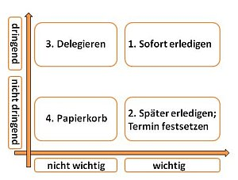Das sogenannte **Eisenhower-Prinzip** (auch: *Eisenhower-Methode*, *Eisenhower-Matrix*) ist eine in der Ratgeber- und [Consulting](https://de.wikipedia.org/wiki/Consulting)literatur oft referenzierte Möglichkeit, anstehende Aufgaben in Kategorien einzuteilen. Dadurch sollen die wichtigsten Aufgaben zuerst erledigt und unwichtige Dinge aussortiert werden. Es gibt keine Hinweise darauf, dass der namensgebende US-Präsident und Alliierten-General [Dwight D. Eisenhower](https://de.wikipedia.org/wiki/Dwight_D._Eisenhower) sie selbst praktiziert oder gelehrt hat.

Anhand der Kriterien [Wichtigkeit](https://de.wikipedia.org/wiki/Wichtigkeit) (wichtig/nicht wichtig) und [Dringlichkeit](https://de.wikipedia.org/wiki/Dringlichkeit) (dringend/nicht dringend) gibt es vier Kombinationsmöglichkeiten. Die vier Aufgabentypen werden auf vier [Quadranten](https://de.wikipedia.org/wiki/Quadrant) verteilt: Jedem Aufgabentyp wird eine bestimmte Art der Bearbeitung zugeordnet.

Die übliche Tendenz, dringendes vor wichtigem zu erledigen, sollte durchbrochen werden: 2 vor 3!

Aufgaben im 4. Quadranten werden *nicht* erledigt.

## Entscheidungsfolgen-Matrix

Entscheidet ein Entscheider nicht, fehlt ihm Ihre Entscheidungsvorarbeit. So verrückt es klingt: Die meisten Projektmanager wurden niemals in erster Hilfe bei Entscheidungsstau, also in **Entscheidungsvorbereitung**, ausgebildet obwohl hinter jeder Kurve ein Stau drohen kann! Dieses Versäumnis beheben wir jetzt.

Wenn Entscheider nicht entscheiden, dann meist, weil ihnen die Folgen der Entscheidung nicht klar sind. Und ohne diese Auswirkungen zu kennen, entscheidet kein vernünftiger Mensch. Zeigen Sie Ihrem Entscheider die Folgen auf. Zeigen Sie ihm diese Folgen für alle möglichen Entscheidungen auf, einschließlich der Nullentscheidung (er entscheidet nicht).

Zeigen Sie ihm die Auswirkungen der alternativen Entscheidungen auf:

-   **Q** -die Qualität, also das Projektergebnis
-   **T** -Zeitaufwand, Zeitverzögerungen und Termine
-   **K** -die Kosten, Budget, Mehrkosten
-   **P** -eventuellen Personalmehraufwand

Damit Ihr Entscheider die Entscheidung nicht weiter verzögert, erzählen oder schreiben Sie keinen Roman über die Entscheidungsfolgen, sondern visualisieren Sie die Auswirkungen in einer **Entscheidungsfolgen-Matrix**. Für unser Beispiel sieht die Matrix so aus:

|  **Entscheidung** | **Billiges Material**    | **Teueres Material** | **Wird nicht betroffen bis zum 17.8. getroffen**          |
|-------------------|--------------------------|----------------------|-----------------------------------------------------------|
| **Qualität**      | 3 Anwendungen fallen weg | Wird voll erreicht   | Nur Minimallösung möglich                                 |
| **Termin**        | Keine                    | Keine                | Endtermin nicht zu halten                                 |
| **Kosten**        | 0                        | 5                    | 50000 als Strafe                                          |
| **Personal**      | Keines                   | 1 Person             | 8 Personen wenn Endtermin nach 17,8, gehalten werden soll |

Die Entscheidungsfolgen-Matrix zeigt dem Entscheider auf einen Blick, was passiert, wenn er entscheidet oder nicht entscheidet. Er hat also den Überblick was für Manager immer eine entscheidungsaus- lösende Voraussetzung ist. Trotzdem könnte ihm die Wahl zwischen den Entscheidungen noch schwerfallen. Also geben Sie ihm eine zusätzliche Orientierung:

**Sprechen Sie eine Empfehlung aus: «Aufgrund unserer vereinbarten obersten Projektpriorität empfiehlt das Projektteam die Entscheidung...»**

Projektpriorität? Ja, die hat jedes Projekt oder sollte es zumindest haben. Diese Priorität notiert ein erfahrener Projektmanager bereits bei der Auftragsklärung oder spätestens bei der Grobplanung mit dem Auftraggeber und gibt diese Notiz auch (Erfordernis der Schriftform, s. Kapitel 2, Seite 24) dem Auftraggeber zur Kenntnis damit er nicht wieder vergisst, dass er zum Beispiel gesagt hat: «Den Termin müssen wir unbedingt halten. Wenn’s klemmt, müssen wir eben mehr Geld locker machen.» Aus dieser Äußerung ergibt sich folgende Rangfolge der Prioritäten:

**1. Priorität = T: Termin unbedingt halten**

**2. Priorität = Q: Qualität, also das Projektergebnis**

**3. Priorität = K: die Kosten, das Budget.**

Das heisst, in diesem Projekt können Sie Ihrem Entscheider bei Entscheidungsstau immer jene Entscheidung empfehlen, welche den Endtermin sichert und das Ergebnis hält auch wenn es etwas mehr kostet.

Helfen Sie dem Entscheider noch stärker, indem Sie ihm klipp und klar sagen, was zu tun ist: «Um die empfohlenen Konsequenzen zu realisieren, um also das Projekt noch rechtzeitig zu einem hundertprozentigen Ergebnis zu fuhren, brauchen wir Ihre Entscheidung bis spätestens…

# Projektablauf & Vorgehensmodelle

Dieser Teil widmet sich dem so genannten „Project Life Cycle“ – dem Projektablauf, also dem Riten Faden, der alles zusammenhält.

Die Session kreist um die Fragen:

-   Wie sieht das „Project Life Cycle“ aus?
-   Welche Vorgehensmodelle gibt es?
-   *Wie werden Projekte in Abschnitte (Phasen) gegliedert?*
-   *Welche Abfolge weisen diese Abschnitte auf?*
-   *Unterschied zwischen sequenziellen und iterativen Modellen?*
-   *Eignung für allgemeine IT-Projekte, bzw. reine SW-Projekte*

Mögliche Resultate zur Erarbeitung:

-   Phasenmodelle mit ihren Phasen kennen
-   Phasenübergänge (Meilensteine)
-   Wie lassen sich die „Einzelteile“ wie Aufgaben, Dokumente, etc. den Phasen zuordnen?
-   Fokus der einzelnen Phasen

## Von der Chaostheorie zum Projektablauf

Die Chaostheorie wirft Fragen auf, die von grundsätzlichem Interesse sind: Gibt es Strukturen, Muster und Prozesse, die sich in allen Erscheinungen der Natur, der Gesellschaft, der Kultur in gleicher Weise widerspiegeln? Wie entsteht aus Ordnung Chaos und umgekehrt? Was sind die treibenden Faktoren für Veränderungen? Wie, wann und warum kippt ein ordentlich funktionierendes System um?

Chaos ist eine Ordnung, die wir nicht durchschauen. Von Chaos redet man, wenn ein System regellos erscheint, wenn man keinerlei Erkenntnis hat über die Systematik eines Systems, wenn der jeweils nächste Messpunkt nicht prognostiziert werden kann. Inzwischen sind Forscher der Meinung, dass fast alle zunächst regelmässigen Entwicklungen in Chaos umschlagen können, wenn sich gewisse (sogar geringfügige) Einflussgrössen ändern. Ein erster Hinweis ist es, wenn eine Messkurve, die bisher regelmässig verlief, sich an einem Punkt plötzlich verändert oder verzweigt.

Auch chaotische Projekte (sprich: Projekte, deren Ordnung wir nicht durchschauen) können zum Ziel kommen. Leider braucht es dazu relativ viel Zeit. Alle Projektplanungsaufgaben dienen dazu, das in Projekten von Natur aus innewohnende Chaos in eine **sichtbare** Struktur zu bringen – um Zeit und Ressourcen zu sparen. Einige Beispiele, die Zeit und Geld kosten:

-   Projektmitarbeiter, die darauf warten, dass sich ein Entscheidungsverantwortlicher „outet“
-   Expresslieferungszuschläge
-   Pontius-zu-Pilatus-Botengänge
-   Technische Hilfsmittel, die „Express“ besorgt werden müssen
-   Projektmitarbeiter, die auf Ergebnisse anderer Projektbeteiligten warten müssen
-   Lange Sitzungen, um die geplanten „ad-hoc-Entscheide“ zu fällen

**Projektmanagement bedeutet, Struktur ins Chaos zu bringen** – wenigstens für die Dauer eines Projektes. Konkret bedeutet das:

Projekte sollten eine für alle Projektbeteiligten sichtbare Projektstruktur oder Projektordnung aufweisen. Für alle sichtbar heisst, dass alle Beteiligte in den Strukturen eine „Ordnung“ erkennen. Auf diese Ordnung muss man sich meistens einigen, da bestimmt nicht alle Projektbeteiligte das Gleiche unter Ordnung und Struktur verstehen (siehe auch Lern- und Arbeitsstile...).

Verschiedene Modelle mit ihren Vor- und Nachteilen bieten sich nun an eine Struktur in den Ablauf des Projektes zu bringen. Man unterscheidet grundsätzlich zwischen den klassischen Phasenmodell und modernen Vorgehensmodellen (iterativ, agil):

## Ziele methodischen Vorgehens

Ordnung ins Chaos zu bringen bedeutet methodisches Vorgehen, egal ob klassisch oder modern. Wir sind uns bewusst, dass methodisches, geplantes Vorgehen keine Garantie für den Projekterfolg darstellt. Warum planen wir dann? Warum entstanden Projektmanagement-Modelle und –Methoden überhaupt? Was sind die Ziele des methodischen Vorgehens?

Die Ziele des methodischen Vorgehens sind:

| **Ziel - Wie es in der Literatur steht** | **Was es bedeutet**                                                                                                                                                                                                                                               |
|------------------------------------------|-------------------------------------------------------------------------------------------------------------------------------------------------------------------------------------------------------------------------------------------------------------------|
| Sicherstellen der Zielanpeilung          | Richtige Ziele erkennen und verfolgen                                                                                                                                                                                                                             |
| Steuerung des Projektes sicherstellen    | Sofort sehen können, welche „Kräfte“ auf das Projekt wirken und eingreifen können                                                                                                                                                                                 |
| Planungshilfen bereitstellen             | Die Grundstruktur von Projekten muss dann nicht jedes Mal neu geplant werden und die Koordination der Beteiligten wird erleichtert, wenn jeder das Projekt im Ganzen durchschaut                                                                                  |
| Begrenzungen erkennen                    | Der Handlungsspielraum – was ist zu beachten, welche Restriktionen sind einzuhalten, was darf nicht herauskommen, was darf wer entscheiden – soll möglichst früh erkannt werden, um kostspielige Verzögerungen oder Fehlentwicklungen zu vermeiden                |
| Beherrschen komplexer Probleme           | Methode(n) soll(en) gewährleisten, dass Die gedankliche Auseinandersetzung mit deinem Problem vereinfacht und geordnet wird Bei der Arbeit im Detail der Überblick nicht verloren geht Einzellösungen miteinander verträglich sind Insellösungen vermieden werden |
| Rationalisierungspotentiale nutzen       | Mehrfach benötigte Faktoren (Informationen, Sachmittel, Vorlagen, Abläufe, Programme, etc.) sollen  Möglichst nur einmal entwickelt oder bereitgestellt werden Möglichst standardisiert werden                                                                    |

## Project Life Cycle

Von der Vorbereitung, bis hin zum endgültigen Projektabschluss, bezeichnet der **Projektlebenszyklus** die Gesamtheit aller Phasen eines Projekts. Häufig wird auch vom „Projektlebensweg“ gesprochen, da jedes Projekt in seinem Lebenszyklus einmalig ist und in exakt derselben Ausführung kein zweites Mal zu finden sein wird. Auch wenn jedes Projekt in seiner Gesamtheit einzigartig ist, gibt es dennoch bestimmte Phasen, die jedes Projekt durchläuft, oder zumindest durchlaufen sollte. Bei der Frage um wie viele Projektphasen es sich hierbei genau handelt, sind sich die Projektmanager nicht immer ganz einig, da dies teilweise vom jeweiligen Projekt, sowie von der spezifischen Branche, in welcher das Projekt ausgeführt wird, abhängt.

Das Phasenmodell kann dem Projekt entsprechend angepasst werden. Es können andere Phasen und andere Phaseninhalte bestimmt werden – wichtig ist nur, dass sich alle über den Ablauf und die Inhalte der Phasen einig sind. Hier die typischen Tätigkeiten der vier "Hauptphasen":

| **Phase**                  | **Beschreibung / Tätigkeiten**                                                                                                                                                                                                    | **Zu erarbeitende Resultate / Dokumente**                                                                                                                                                                                                                                                        |
|----------------------------|-----------------------------------------------------------------------------------------------------------------------------------------------------------------------------------------------------------------------------------|--------------------------------------------------------------------------------------------------------------------------------------------------------------------------------------------------------------------------------------------------------------------------------------------------|
| **1. Projektdefinition**   | Zieldefinition mit dem Auftraggeber, Definition des Projektumfanges Erstellung der ersten, groben Projektpläne Erstellung von Pflichtenheften, Verträgen, etc. (Baseline) Bestimmung von Organisation, Dokumentation, Information | Baseline, bestehend z.B. aus Offerte und Verträgen. Grober Projektplan Dokumentationsplan (oder –system) Informationsplan (oder –system) Change Management System (Ablauf, Dokumentation, Formulare)                                                                                             |
| **2. Projektplanung**      | Planung und Dokumentation aller benötigten Planungsobjekten                                                                                                                                                                       | Projektpläne z.B.: WBS (Auflistung der einzelnen Aufgaben mit Aufwand und Ressourcen) Gantt (Aufzeichnung über Abfolge und Zusammenhang der einzelnen Aufgaben) Einzelpläne in höherem Detaillierungsgrad (z.B. Testplan, Produktionsplan) Budgets, Verrechnungsplan Schulungsplan Risikoanalyse |
| **3. Projektdurchführung** | Realisierung aller geplanten Leistungen Testen der Liefereinheiten, Durchführung der Testpläne                                                                                                                                    | „Greifbare“ Resultate inkl. Dokumentation Protokolle Fortschrittsberichte                                                                                                                                                                                                                        |
| **4. Projektabschluss**    | Übergabe des „Produktes“ an den Auftraggeber, inklusive Dokumentation Schulung der Benutzer Rechnungsstellung Nachkalkulation des Projektes, Debriefing (Lessons learned)                                                         | Abnahmeprotokoll                                                                                                                                                                                                                                                                                 |

Die Projektleitung muss dafür besorgt sein, dass die Resultate erstellt werden – auch wenn sie es nicht selbst erledigt.

### Meilensteine

= Eintritts- bzw. Austrittskriterium

Jede Phase wird durch einen Meilenstein begonnen bzw. abgeschlossen. Diese Kriterien oder Meilensteine müssen definiert werden. (Die Länge der Pfeile in der vorangehenden Grafik hat übrigens keinen Bezug zur Länge der Projektphasen.)

Beispiel für Eintritts- und Austrittskriterium:

*Mit der Phase Projektplanung, in der die detaillierten Projektpläne erstellt werden, sollte erst begonnen werden, wenn die Projektdefinition vollständig abgeschlossen (z.B. vom Kunden abgenommen) ist – ansonsten läuft man Gefahr, Vorgänge und Ressourcen zu planen, die keinen Bezug zum Projekt haben. Das kostet Zeit und Geld.*

## Phasenmodelle (klassisch)

Es gibt unterschiedliche Phasenmodelle (standardisierte Projektstrukturen für die Erstellung des Projektprodukts), je nachdem, welche Art Projektprodukt erstellt wird.

| **IPERKA** *Bekanntes Phasenmodell für kleine* **IT-Projekte***. Bekannt aus dem Modul 431. Nicht geeignet für* **Software***-***Projekte***.* | 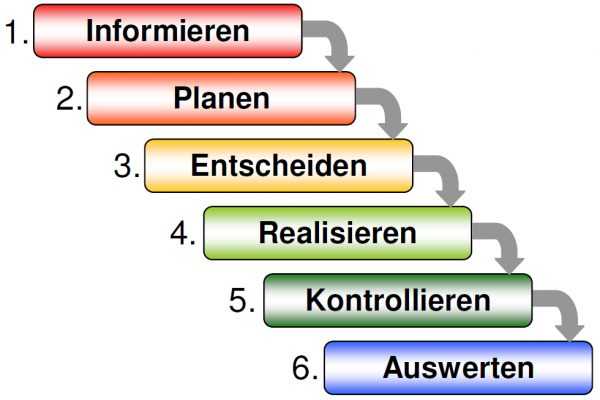 |
|------------------------------------------------------------------------------------------------------------------------------------------------|-------------------------------------------------------------------------------------------------------|
| **Wasserfall** *geeignet für* **Software***-***Projekte**                                                                                      | 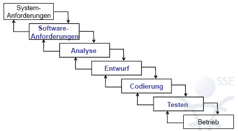                                                       |
| **V-Modell XT**                                                                                                                                | 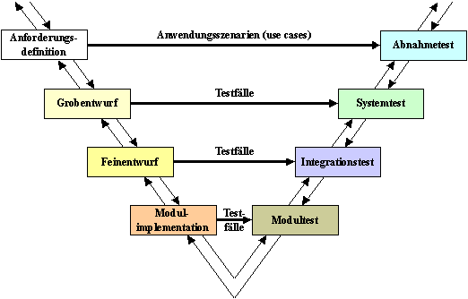                           |
| **HERMES** *2 Varianten: - Systementwicklung - Systemadaption*                                                                                 | 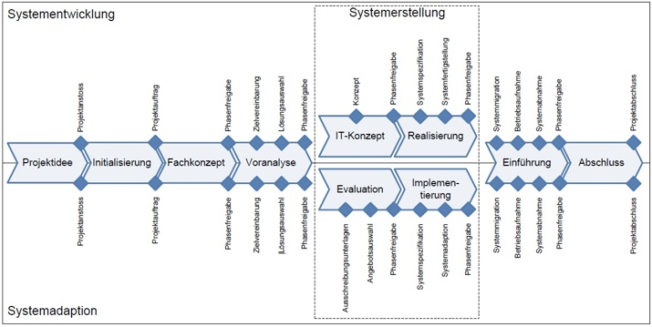                                               |
| **Rational Unified Process (RUP)** *Zweidimensional:  - Phasen - Disziplinen*                                                                  | 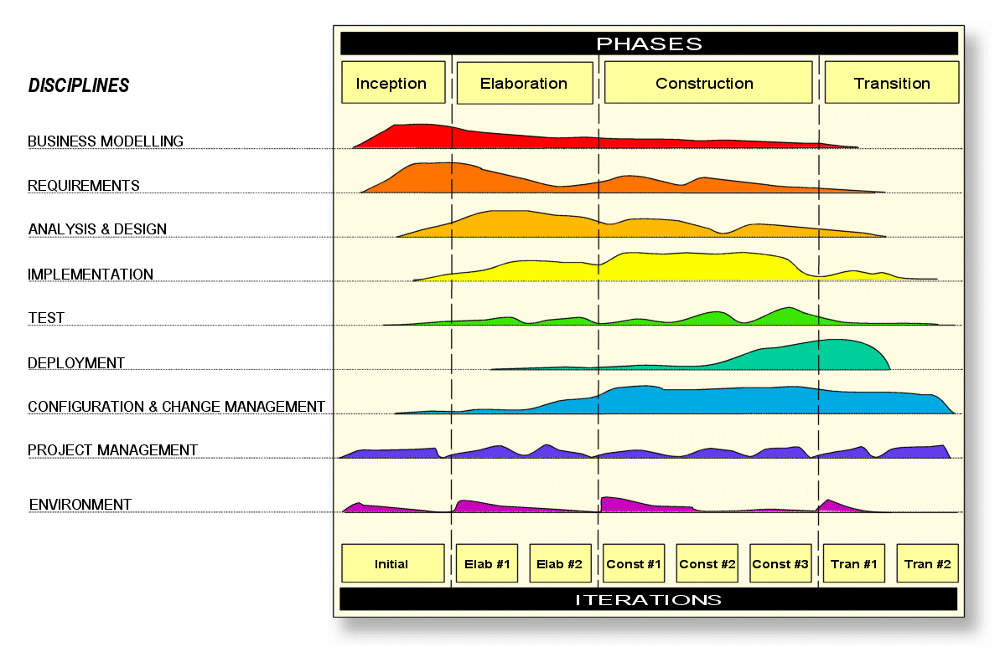                                                       |

## Iterative Vorgehensmodelle (Agil)

Wenn schnelle, flexible Entwicklung gewünscht ist, eignen sich eher Vorgehensmodelle mit sich abwechselnd wiederholenden Teilabschnitten:

| **Code & Fix** *Ist kein agiles Vorgehensmodell* *Aber trotzdem geeignet, wenn Nutzer und Programmierer dieselbe Person sind* *Oder der Programmierer ein Anfänger ist* *Kleine* **Software-Projekte** |  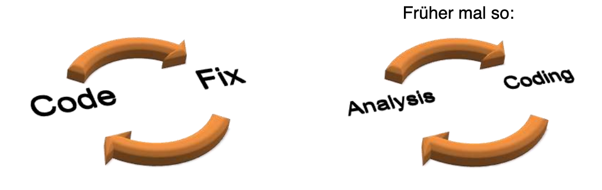                                                  |
|--------------------------------------------------------------------------------------------------------------------------------------------------------------------------------------------------------|---------------------------------------------------------------------------------------------------|
| **Prototyping** *Evolutionäres Exploratives Experimentelles ...*                                                                                                                                       |  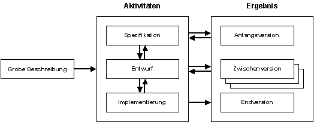 Evolutionäres Prototyping* * |
| **Spiralmodell**                                                                                                                                                                                       | 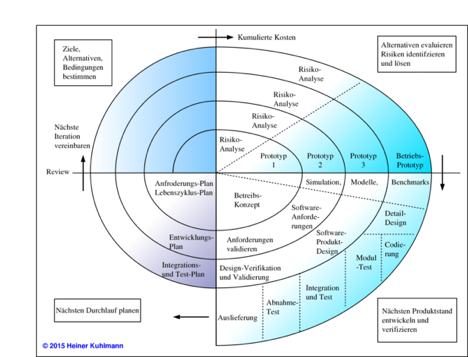                                       |

Als Antwort auf den Einsatz der schwergewichtigen Vorgehensmodelle der Anforderungsanalyse und der Anwendungsentwicklung wie zum Beispiel das V-Modell oder den [Rational Unified Process (RUP)](http://www.infforum.de/themen/anwendungsentwicklung/se-rup.htm) ist ein "agiles" Vorgehen in der Softwareentwicklung entstanden:

| **Agile Scrum** *Ken Schwaber / Mike Beedle für* **Software***-***Projekte**                                                                                                                                                          |  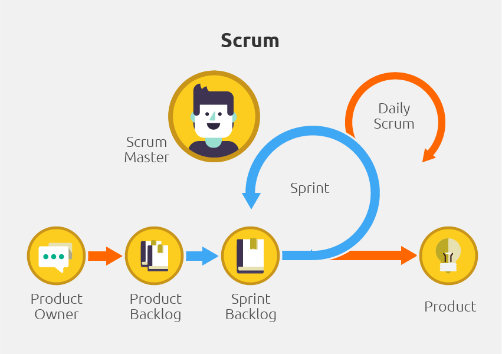                                                                                          |
|---------------------------------------------------------------------------------------------------------------------------------------------------------------------------------------------------------------------------------------|------------------------------------------------------------------------------------------------------------------------------------------------------------------------------------------------------|
| **Agile XP** *Kent Beck / Ward Cunningham / Ron Jeffries für* **Software***-***Projekte**                                                                                                                                             |  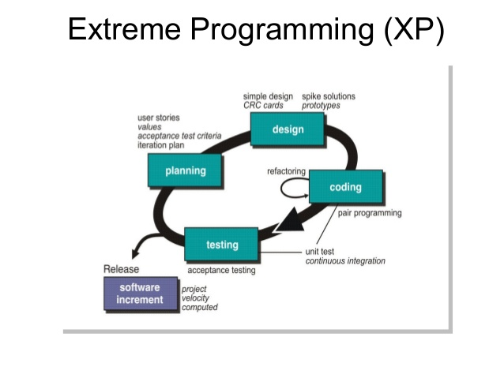                                                                                                           |
| **Weitere:** *(für Software-Projekte)* James A. Highsmith: **ASD** - Adaptive Software Development,  Alistair Cockburn: **Crystal** - Agile Software Development,  Jennifer Stapleton: **DSDM** - Dynamic Systems Development Method  |   Peter Coad / Eric Lefebvre / Jeff De Luca: **FDD** - Feature-Driven Development,  Mary und Tom Poppendieck: **LD** - Lean Development,  Andrew Hunt / David Thomas: **PP** - Pragmatic Programming |

Folgendes Vorgehensmodell wird zwar oft zu den agilen Modellen gezählt ist aber je nach praktischer Umsetzung auch als klassisches Modell verstehbar.[^2] Im Falle eines agilen Einsatzes muss das Manifest eingehalten werden:

[^2]: https://www.forbes.com/sites/stevedenning/2012/09/25/what-exactly-is-agile-is-kanban-agile/

| **Kanban**  |  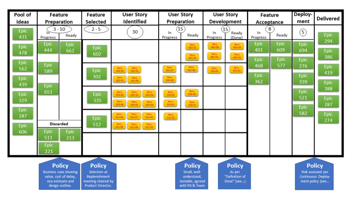  |
|-------------|-----------------------------------------------------------------------------------|

### Manifest für Agile Softwareentwicklung

"Wir erschließen bessere Wege, Software zu entwickeln, indem wir es selbst tun und anderen dabei helfen.

Durch diese Tätigkeit haben wir diese Werte zu schätzen gelernt:

-   **Individuen und Interaktionen** mehr als **Prozesse und Werkzeuge**
-   **Funktionierende Software** mehr als **umfassende Dokumentation**
-   **Zusammenarbeit mit dem Kunden** mehr als **Vertragsverhandlung**
-   **Reagieren auf Veränderung** mehr als das **Befolgen eines Plans**
-   **...**

Das heißt, obwohl wir die Werte auf der rechten Seite wichtig finden, schätzen wir die Werte auf der linken Seite höher ein."

Siehe auch <https://agilemanifesto.org/iso/de/manifesto.html>

### Phasenmodelle vs. Iterative Vorgehensmodelle

Der Leitgedanke des [iterativen](https://www.inloox.de/unternehmen/blog/artikel/agiles-projektmanagement/) Vorgehensmodell basiert auf Flexibilität, Anpassung und Selbstorganisation. Wohingegen im klassischen Phasenmodell das Projekt bereits vorab phasenorientiert durchgeplant wird.

Die Vorteile des agilen Vorgehens sind unter anderem der stark ausgeprägte Teamgedanke, und der kontinuierliche Verbesserungsprozess durch Sprints. Nach jedem Sprint folgt immer eine [Retrospektive](https://www.inloox.de/projektmanagement-glossar/retrospektive/), um aus den gemachten Erfahrungen zu lernen.

Doch auch die strikte Vorabplanung der klassischen Phasenmodelle hat einige Vorteile. Zum einen hat das Projektteam eine klare Vorgabe dazu, wie das Projekt ablaufen soll. Dadurch können u.a. die Ressourcen für die gesamte Projektdauer fest zugeteilt und die Kosten des Projektes bereits im Voraus geschätzt werden. Zum anderen ermöglichen klassische Methoden, die Vorab-Vereinbarung des Endtermins und geben dem Auftraggeber damit eine gewisse Sicherheit.

Unternehmen unterscheiden üblicherweise strikt zwischen Projekten nach klassischen oder agilen Prinzipien.

# Planung

In diesem Teil beleuchten wir die Ziele, Schwierigkeiten und Umfang der Projektplanung.

Folgende Fragen wollen wir klären:

-   *Was sind die Ziele der Planung und wie können sie erreicht werden?*
-   *Welche Planungsobjekte betreffen unsere Projekte?*
-   *Welche Planungstools gibt es?*
-   *Wie kann die Projektplanung dokumentiert werden?*

## Ein paar banale Wahrheiten

-   Ohne vernünftige Aufwandschätzungen gibt es keine vernünftige Planung.
-   Prognosen sind schwierig, weil sie sich auf die Zukunft beziehen.
-   Die besten Aufwandschätzungen macht man zu Projekt-Ende (Erfahrungswerte).
-   Ohne ein Dokumentationssystem gehen (fast) alle Erfahrungswerte wieder verloren oder sind zumindest nicht mehr nachvollziehbar.
-   Was nicht geplant war, wird auch nicht umgesetzt. Beispiel: Wird der Informationsaustausch nicht von Anfang an geplant, findet dieser auch nicht - oder zumindest nicht in ausreichender Qualität – statt.

## Wer plant?

Der Projektleiter trägt die Verantwortung für den Projekterfolg. Deshalb kann er/sie die Verantwortung für die Planung auf keinen Fall delegieren. Er/Sie ist dafür verantwortlich, **alle** **Daten** für die Planung von den richtigen Quellen einzuholen und dabei **alle Planungsobjekte** (s. Seite 40) zu berücksichtigen.

Während der Projektleiter die Planung macht, wartet das Projektteam geduldig auf die Resultate .... nein, natürlich nicht – die Projektmitglieder sind schliesslich die Fachexperten! Der Projektleiter wird sich an die einzelnen Fachexperten wenden und mit ihnen zusammen die Planung erstellen.

Für den Planungsablauf bedeutet das:

-   Der Projektleiter ist bereits bei der Erstellung der Offerte zu bei zu ziehen, da diese dem Kunden zum ersten Mal Aufwände kommuniziert.
-   Der Projektleiter trägt die Verantwortung dafür, dass Fachexperten beigezogen werden (mit dem Team "schätzen").
-   Der Projektleiter muss dafür sorgen, dass Erfahrungswerte nicht verloren gehen (z.B. mit einer Nachkalkulation, Schätzungsabweichungen ermitteln, i.d.R. ±50%).
-   Der Projektleiter hat die Verantwortung für die Kommunikation der Pläne und deren Änderungen an alle Beteiligten.

## Ziele der Projektplanung

Mit der Projektplanung werden immer drei Grundsätze verfolgt:

1.  **Transparenz**  
    Alle Ergebnisse der Planung müssen in Form von grafischen Darstellungen, Diagrammen, Tabellen, Beschreibungen etc. festgehalten werden – und zwar so, dass sie für alle Beteiligten eindeutig verständlich sind.
2.  **Kommunikation  
    **Die Pläne sollen eine effiziente Kommunikation zwischen den Projektbeteiligten ermöglichen und eine sinnvolle Ausrichtung ihrer Anstrengungen auf die Projektziele fördern (sprich: sie dazu bringen, die Termine einzuhalten).
3.  **Kontrolle  
    **Aus den Plänen sollte jederzeit der Fortschritt des Projektes ersichtlich sein. Ausserdem zeigen Pläne auf, wie eine Änderung des Projektumfanges sich auf die Erreichung der Projektziele auswirken wird.

Aus der Planung muss ersichtlich sein:

-   Höhe der erwarteten Kosten / des erwarteten Zeitaufwandes
-   Logische Reihenfolge der Aufgaben und ihre Parameter (Zeitpunkt, Ort, Dauer, Menge)
-   Zuständigkeiten für die einzelnen Aufgaben, wer, wo, wann und in welcher Form welches Resultat abliefern muss
-   Wann, wo und durch wen die Qualitätssicherung (Testen, Prüfen, Abnehmen) durchgeführt wird

## Planungsobjekte

Für ein Projekt wird nicht nur ein Plan erstellt, sondern ein komplexes System von Plänen. Für jedes Projekt muss überlegt werden, welche Planungsobjekte betroffen sind – ob beispielsweise geschult werden muss oder nicht. Die Pläne zu den einzelnen Objekten werden - falls nötig - in verschiedenen Detaillierungsgraden erstellt.

Eine – nicht abschliessende – Liste mit den möglichen **Planungsobjekten**:

| **Inhalte der Projektplanung** | Planung der Projektziele                                             |   | Ermittlung, Strukturierung, Operationalisierung und Gewichtung der Projektziele und Abstimmung mit dem Auftraggeber. Zielformulierungstechniken verwenden.                                                                                  |
|--------------------------------|----------------------------------------------------------------------|---|---------------------------------------------------------------------------------------------------------------------------------------------------------------------------------------------------------------------------------------------|
|                                | Planung der Aufgaben                                                 |   | Auflistung der Aufgaben, Bestimmung der Reihenfolge und Zuteilung der Verantwortlichkeit. Aufwand- und Zeitplanung können nur erfolgen, wenn alle im Projekt zu erledigenden Aufgaben bekannt sind. Soweit wie möglich / nötig detaillieren |
|                                | Planung von Zeitaufwand und –Dauer für die gesamte Projektabwicklung |   | Ist der Aufwand für die Aufgaben im Projekt bekannt, kann der Projektleiter – unter Berücksichtigung der verfügbaren Ressourcen – die Projektzeitdauer planen.                                                                              |
|                                | Planung der Aufbauorganisation des Projektes                         |   | Bestimmen, welche Qualifikationen / Rollen / Personen in welchem Umfang für das Projekt benötigt werden. Lässt sich aus den Aufgaben ableiten. „Kundenorganisation“ berücksichtigen (Entscheider, Mitarbeiter, etc.)                        |
|                                | Ressourcenplanung                                                    |   | Planung aller Ressourcen (Mitarbeiter, Technik, Räume, etc.) und Erstellung des Budgets                                                                                                                                                     |
|                                | Planung des Projektablauf                                            |   | Zeitliche und logische Abhängigkeiten zwischen den Aufgaben (Gantt, Netzplan, Projektstrukturplan) aufzeichnen. Aufteilung des Projektes in Phasen, Bestimmung der Meilensteine.                                                            |
|                                | Planung der Qualitätssicherung                                       |   | Testplan mit Testverfahren, Testumgebung und Testverantwortliche bestimmen.                                                                                                                                                                 |
|                                | Planung Projektinformation &-dokumentation                           |   | Kommunikationsplan und Dokumentationsplan erstellen.                                                                                                                                                                                        |
|                                | Projektmarketing                                                     |   | Massnahmen, um die Akzeptanz des Projektes bei den Betroffenen zu sichern.                                                                                                                                                                  |

## Planungsmethoden

Wer ein richtiger Projektleiter ist, der kennt auch den Planungsjargon: Strukturplan, Gantt, PERT, CPM, MPM, wobei die letzteren drei zu der Familie der Netzplantechniken gehören. Wichtig: Alle diese Planungsmethoden dienen der Darstellung / Planung von Arbeitsabläufen bzw. Arbeitspaketen. Die übrigen Planungsobjekte werden in diesen Plänen nicht oder nur zum Teil dargestellt. Die Aufteilung in Arbeitspakete hängt auch vom gewählten Vorgehensmodell ab, z.B. bezüglich Grösse und Zuständigkeiten.

### WBS/PSP (Work Breakdown Structure / Projekt Struktur Plan)

Mit der WBS, oder zu deutsch PSP, versucht man zu Beginn der Planung die Projektaufgaben zu sammeln und aufzuteilen: Für die Erstellung einer WBS wird das Projekt in die kleinsten sinnvollen Schritte unterteilt, sog. Arbeitspakete. Wie grob diese Unterteilung ausfällt ist abhängig von Grösse und Komplexität des Projektes. Bei der Unterteilung wird der zeitliche Aspekt (noch) nicht berücksichtigt. Die Unterteilung geschieht in drei strukturellen Ebenen: 1) Systemebene, 2) Teilaufgabenebene und 3) Arbeitspaketebene:

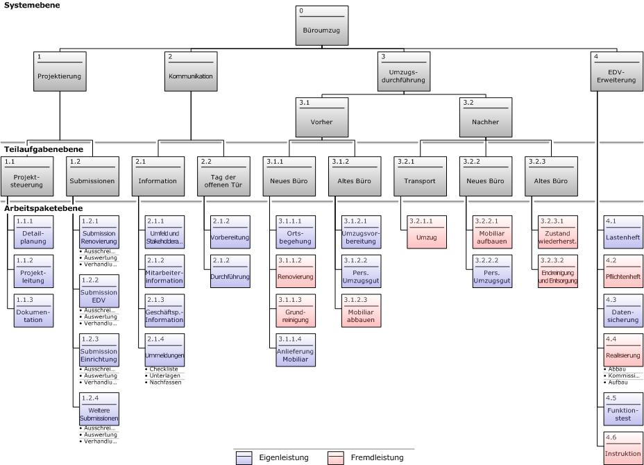

Die **Arbeitspakete** werden durchnummeriert und in den nachfolgenden Diagrammen entsprechend referenziert.

### PERT

Steht für *Program Evaluation Rewiew Technique* und wurde von der US Navy in den 50er Jahren für das „Polaris Submarine Missile Project entwickelt“. Wahrscheinlich ganz gut geeignet, wenn man eine Invasion plant – sofern man nach dem Planen noch Zeit für die Durchführung hat. Die Methode ist nicht einfach zu lernen und das Resultat sieht ungefähr so aus:

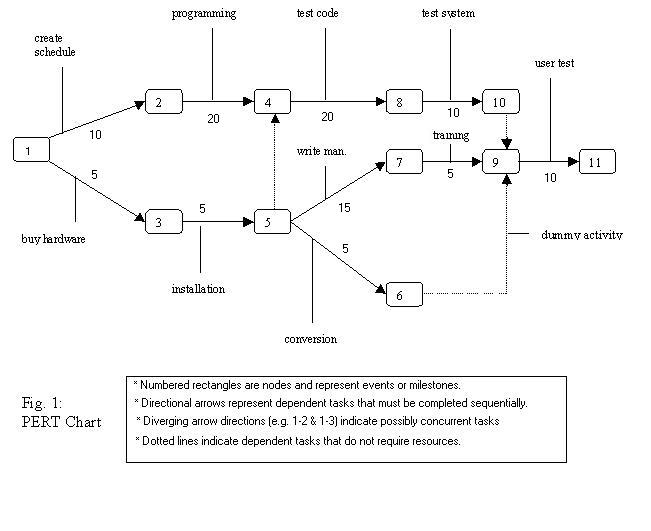

### CPM

Steht für *Critial Path Method*. Ist eigentlich eine für die Industrie angepasste Form des PERT (wird deshalb auch PERT/CPM genannt). Die Entwicklungsabteilung der BMW plant ihre Entwicklungsprojekte nach CPM. Der Sage nach braucht die Planungssoftware zur Durchrechnung einer Planänderung bis zu einem Tag. Vorteil: Aus dem CPM-Plan ist der sogenannte „Kritische Pfad“ sofort ersichtlich. Aktivitäten, die auf dem kritischen Pfad liegen, bestimmen die Länge (und auch die Verspätungen) des Projektes.

Beispiel Lagerhalle:

Die dargestellten Blöcke stellen durchnummerierte Tätigkeiten (Referenz WBS) dar, die durchzuführen sind. Die Eintragungen bedeuten oberhalb des Blocks die frühesten Termine, unterhalb die spätesten Termine und im Block. Im Block werden die sich daraus ergebenden Zeiten wie Dauer und Pufferzeiten berechnet.

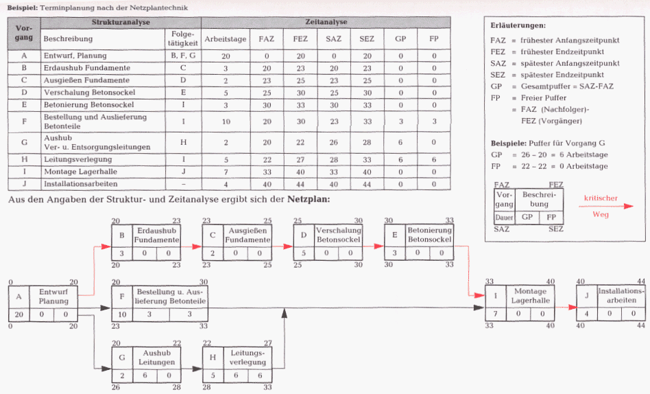

Die Pfeile setzen (und berechnen dadurch) die Abhängigkeiten der Tätigkeiten. Die mit roten Pfeilen verbundenen Blöcke stellen den **kritischen Pfad** dar. Verzögerungen in diesen Tätigkeiten führen automatisch zu Verzögerungen des Gesamtprojekts. Die anderen Blöcke verfügen dadurch über Pufferzeiten.

### MPM

Steht für *Metra Potential Method* und ist die europäische Variante der Netzplantechniken.

Netzpläne lassen sich z.B. in MS Project erstellen.

### Gantt

Die Gantt-Methode (von Henry L. Gantt, amerikanischer Ingenieur) wurde zur Kontrolle von Produktionsabläufen entwickelt und ist seit 1917 die ungeschlagene Siegerin unter den Planungsmethoden.

Das Gantt-Diagramm, auch Balkenplan genannt, ist eine Darstellung der Ablauf- und Terminplanung. Gantt-Diagramme stellen die terminliche Lage sehr anschaulich und übersichtlich dar, können allerdings die Abhängigkeiten zwischen den Vorgängen nicht abbilden – im Gegensatz zu den Netzplantechniken. Jede Planungssoftware, die was auf sich hält, kann ein Gantt-Diagramm zeichnen.

Einfaches Beispiel:

Zu erkennen sind die Phasen „Vorstudie“ und „Vorbereitung“ mit den einzelnen Aufgaben.

Die Raute bezeichnet einen Meilenstein (Milestone). Projektmeilensteine sind Zeitpunkte (Achtung: Zeitpunkt, nicht Zeitdauer!), an denen entweder eine Entscheidung fällt oder ein Resultat abgenommen wird. In Projektplänen haben sie immer eine Dauer von „0“ und werden durch ein spezielles Symbol gekennzeichnet.

Meilensteine sind wichtige Projektzeitpunkte: Wird einer nicht eingehalten, weil z.B. der Kunde einen Entscheid nicht trifft, verändert das den restlichen Projektplan.

Zu beachten:

1.  Die Phasen des Projekte sind sichtbar (übergeordnet)
2.  Die Arbeitspakete sind in den Phasen eingegliedert (eingerückt) und vom WBS her referenziert
3.  Meilensteine markieren abgeschlossene (und starten neue) Phasen (Sitzungen)
4.  Abhängigkeiten werden durch Pfeile gesetzt ( Netzplan Bezug)
5.  Oft werden auch die Ressourcen zu den Arbeitspaketen (Personal, Betriebsmittel, Material, Lokalitäten, etc) verwaltet.
6.  Beim Fortschritt des Projektes werden die tatsächlichen Zeiten nachgetragen und durch die Abhängigkeiten werden Folgen erkennbar. Korrekturen können eingeleitet werden ( Ressourcen anpassen)

## Planung Kommunikations- und Dokumentationssystems

Wichtig sind vor allem die ausreichende Information der Beteiligten und eine sinnvolle Dokumentation der Projektergebnisse. Eine gute Dokumentation liefert Erfahrungswerte für das nächste Projekt und trägt so zur Qualitätssicherung bei.

Die Planung der Projektinformation lässt sich am einfachsten mit einer Liste realisieren, aus der hervorgeht, wer welche Informationen zu welchem Zeitpunkt auf welchem Kommunikationsweg erhält.

| **Was**               | **Verantwortlich** | **Wann**  | **Form** | **Empfänger**    |
|-----------------------|--------------------|-----------|----------|------------------|
| Fortschrittsbericht 1 | PL                 | xx.xx.xx. | Bericht  | Auftraggeber     |
| Testbericht 1         | XY                 | ...       | Bericht  | PL               |
| Projektplanung        | PL                 | ....      | Sitzung  | Alle (Protokoll) |
| Testergebnisse        | Testleiter         | ...       | Sitzung  | Alle (Protokoll) |

Wichtig ist dabei, dass sich alle Projektbeteiligte an die Vorgaben halten.

Die Planung des Dokumentationsmanagementsystems (DMS) beinhaltet die Regelungen zu:

-   Was wird dokumentiert?
-   In welcher Form?
-   Durch wen?
-   Wann?
-   Wo?

    Auch das lässt sich in einer Liste festhalten:

| **Was?**       | **Zeitpunkt** | **Medium** | **Namenskonvention**                      | **Aufbewahrung?** |
|----------------|---------------|------------|-------------------------------------------|-------------------|
| Projektplan    | Rollend       | MS Project | D:\\projekte\\plan.ppm                    | Kopie in Ordner   |
| Projektauftrag | Projektstart  | Word       | D:\\projekte\\xyz.doc Versionen beachten! | Kopie in Ordner   |
| ....           |               |            |                                           |                   |

### 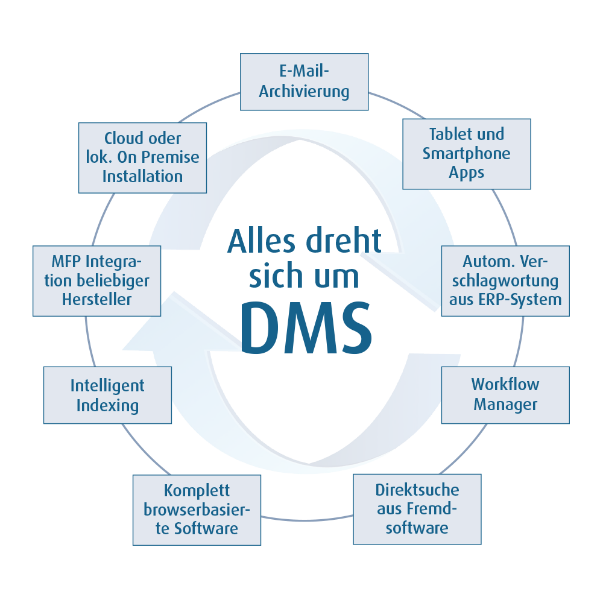Dokumentenmanagementsystem

Dokumentenmanagementsysteme sind komplexe Systeme aus [Datenbankservern](https://de.wikipedia.org/wiki/Datenbank) mit den Dokumentendaten, [Dateiservern](https://de.wikipedia.org/wiki/Dateiserver), auf denen Dokumente im Bearbeitungszustand gehalten werden, mehrstufigen [Archivierungssystemen](https://de.wikipedia.org/wiki/Elektronische_Archivierung), auf denen Dokumente im Endzustand gespeichert werden, [Konvertierungsservern](https://de.wikipedia.org/wiki/Konvertierung_(Informatik)), die diesen Endzustand im Langzeitdateiformat herstellen, und Kommunikationsservern, die die Transaktionen an das Zentralsystem auf Netzwerkprozessebene verwalten.

Oft hängen an einem umfassenden Dokumentenmanagement auch weitere personal-erfordernde Dienste, wie Vorlagenmanagement-Abteilung, Scan-Abteilung, zentrales Druck- und Druckverteil-Zentrum, formale Prüfdienste, Dokumenten-Import und -Export-Dienste (elektronische Kundenschnittstelle), System-Hotline in bis zu 3 Level u. ä.

Der wesentliche Vorteil der leichteren und langfristigeren Wiederauffindbarkeit wird nicht allein durch das elektronische System sichergestellt, sondern durch die Aufstellung und Pflege von Schlagwort-Wörterbüchern (Klassifizierungssysteme, [Thesaurus](https://de.wikipedia.org/wiki/Thesaurus)), [Dokumentenklassen](https://de.wikipedia.org/wiki/Dokumentenklasse) und die entsprechende [Verschlagwortung](https://de.wikipedia.org/wiki/Indexierung) bei der Ablage/beim Speichern von Dokumenten.

Dieses und die durch die Systemkomplexität im Vergleich zu der Dokumentenablage auf einfachen [Dateiservern](https://de.wikipedia.org/wiki/Dateiserver) im Firmennetzwerk mindestens um den Faktor zwei langsamere Ablage von Dokumenten verursacht mehr Aufwand bei allen Mitarbeitern, die ihre Dokumente mit einem Dokumentenmanagementsystem ablegen. Dieser größere Aufwand kommt durch geringeren Aufwand beim Suchen wieder herein, wobei jedoch zu berücksichtigen ist, dass nicht auf jedes in einem Unternehmen einmal abgelegte Dokument noch einmal zugegriffen werden muss. *(Quelle Wikipedia)*

Ein DMs bietet für das Unternehmen folgenden Mehrwert:

1.  Auf Informationen schneller zugreifen
    1.  Ortsunabhängig alle Dokumente im direkten Zugriff
    2.  Alle Informationen gesammelt an einem Ort
    3.  Einhaltung von Gesetzen und Richtlinien
    4.  Besser zusammenarbeiten (Kollaboration)
    5.  Geschäftsprozesse automatisieren

Ein Dokument hat in der Regel folgende Merkmale und wird entsprechend im DMS abgelegt, bzw. abgebildet:

-   physische Eigenschaften ([Papier](https://de.wikipedia.org/wiki/Papier), [Datei](https://de.wikipedia.org/wiki/Datei)),
-   formale Eigenschaften (Aufbau, Gestaltung),
-   Ordnung (fachliche Zugehörigkeit, Reihenfolge, Version, Einordnung in einen [Aktenplan](https://de.wikipedia.org/wiki/Aktenplan)),
-   Inhalt ([inhaltlicher](https://de.wikipedia.org/wiki/Inhalt) Bezug),
-   Charakter (Archivierungswürdigkeit, [Aufbewahrungsverpflichtung](https://de.wikipedia.org/wiki/Aufbewahrungspflicht), Rechtscharakter, Bearbeitungsmöglichkeiten),
-   Zeit (Erzeugungsdatum, Verfallsdatum, letzte Benutzung),
-   Erzeuger (Absender, Ersteller, Autor),
-   Nutzer (Empfänger, berechtigter Bearbeiter, Leser, letzter Bearbeiter).

# Risikoanalyse

Bei der Risikoanalyse handelt es sich um eine „Vorausschauende Diagnose“: Probleme können oft schon vorausgesehen werden. Wenn das früh genug geschieht, kann durch vorbeugende Massnahmen ein Problem verhindert oder zumindest abgeschwächt werden. Die Risikoanalyse beschränkt sich also nicht auf die Identifizierung von Risiken sondern beinhaltet auch den Beschluss von Massnahmen, um die Risiken zu mindern oder auszuschalten.

Es gibt branchen- oder firmentypische Projektrisiken (z.B. in der chemischen Industrie, dass ein neues Medikament nicht zugelassen wird), die in jedem Projekt, welches diese Branche durchführt, vorkommen. Dazu existieren in den betroffenen Firmen allgemeine Risikoanalysen, die für jedes durchzuführende Projekt Massnahmen vorschreiben, um die Risiken zu minimieren und damit schlussendlich finanzielle Verluste zu verhindern. Zum Beispiel müssen bei jedem Bauprojekt die Baupläne von einem externen Statiker geprüft werden, um das Risiko zu minimieren, dass ein Gebäude nach der Erstellung in sich zusammenfällt oder von der Baubehörde nicht abgenommen wird.

## Risikomatrix

Ein Projektrisiko ist ein „unerwünschter Zustand in der Zukunft“ und damit das Umgekehrte eines Projektziels. Jedem Risiko können „Eintretenswahrscheinlichkeit“ und „Tragweite“ zugeordnet werden.

**Risiken bewerten und gewichten** (2C):

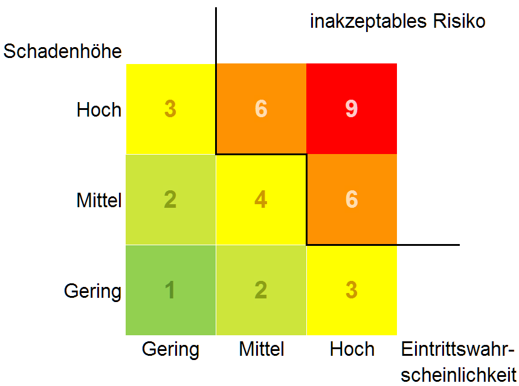Neben diesen „firmentypischen“ Projektrisiken birgt jedes Projekt spezifische Risiken, die meistens auch vom Kunden „mitgebracht“ werden.

Beispiel: Angenommen, in einem Projekt gäbe es nur einen einzigen Entscheidungsbefugten.

Die *Eintretenswahrscheinlichkeit* des Risikos „Zeitknappheit durch Entscheidungsverschleppung“ ist eher klein, da man nur einen Partner in die Entscheide involvieren muss.

Die *Tragweite* des Risikos wäre allerdings eher hoch, da bei Ausfall dieser Person keine Entscheide getroffen werden können.

Als Gegenmassnahme bietet sich hier an, eine Stellvertretung zu bestimmen. Die kritischsten Risiken weisen sowohl eine hohe Wahrscheinlichkeit wie eine hohe Tragweite auf.

Es gibt einige Indikatoren, die auf „vorprogrammierte“ Probleme hinweisen. Typische Krisenindikatoren:

-   „Entscheidungsverschleppung“
-   Unüberbrückbare Meinungsverschiedenheiten in der Projektgruppe
-   Behinderung der sachlichen Arbeit durch persönliche Spannungen
-   Abfällige Bemerkungen von Meinungsmachern über das Projekt oder über Projektbeteiligte
-   Keine eindeutigen Entscheider / Entscheidungswege

Es gibt auch „Hard Facts“, die auf zukünftige Probleme hinweisen: Sachliche Schwierigkeiten (z.B. Technik), verpasste Termine und knappe finanzielle Mittel.

## Vorgehensweise bei der Risikoanalyse

| **Schritte**                                                                                         | **Beschreibung**                                                                                                                                                                                            |
|------------------------------------------------------------------------------------------------------|-------------------------------------------------------------------------------------------------------------------------------------------------------------------------------------------------------------|
| 1. Ziele SMART formulieren                                                                           | M, R und T sind Vorgaben der Risikoanalyse                                                                                                                                                                  |
| 2A. Risikobereiche identifizieren                                                                    | Suche von möglichen Risiken, dabei alle Projektdimensionen beachten (Qualität, Ressourcen, Zeit). Dabei ist es wichtig, die Ursachen der Risiken zu benennen – nicht die Symptome (progressiv abstrahieren) |
| 2B. Symptome benennen                                                                                | Symptome sind Erkennungsmerkmale für Risiken, die anzeigen, ob ein Problem bereits eingetreten ist oder einzutreten droht.                                                                                  |
| 2C. Risiken bewerten und gewichten mittels **Risikomatrix**                                          | Jedem Risiko die Kriterien „Wahrscheinlichkeit des Eintreffens“ und „Tragweite“ zuordnen. (Siehe oben)                                                                                                      |
| 3A. Vorbeugende Massnahmen umsetzen mittels **Risikoanalysetabelle**                                 | Verbindliche Umsetzung von Gegenmassnahmen, die entweder das Problem verhindern oder seine Auswirkungen begrenzen.                                                                                          |
| 3B. Eventualmassnahmen planen   (Alternativplan, Katastrophenplan.) mittels **Risikoanalysetabelle** | Bei besonders kritischen Problembereichen sollten bereits in der Planungsphase alternative Vorgehensweisen vorgesehen werden.                                                                               |

**Die Risikoanalyse kann jederzeit durchgeführt werden**. Mit Vorteil erstellt man die Analyse zu Anfang des Projektes, am besten zusammen mit dem Kunden. Um einen möglichst grossen Nutzen aus der Analyse zu ziehen, sollten die Ergebnisse der Analyse – erkannte Risiken und geplante Gegenmassnahmen – allen Projektbeteiligten mitgeteilt werden.

## Risikoanalysetabelle

Hier ein Beispiel:

| **Risiko**                                  | **Symptome**                                                                    | **Wahrscheinlichkeit** | **Tragweite** | **Gegenmassnahmen** (sofort oder planen)                                                    |
|---------------------------------------------|---------------------------------------------------------------------------------|------------------------|---------------|---------------------------------------------------------------------------------------------|
| Abgabetermin kann nicht eingehalten werden. | Verpasste Meilensteine Kunde will sich nicht entscheiden Zu viele „Mitsprecher“ | Hoch                   | Hoch          | Kunde auf kritische Termine hinweisen, zu Entscheiden verpflichten. **(sofort einleiten!)** |
| Schlechte Qualität des Produktes            | Unerfahrene Mitarbeiter im Bereich Programmierung                               | Mittel                 | Hoch          | Testphase verlängern Externen Experten verpflichten. **(sofort einleiten!)**                |
| Negative  Projektprofitabilität             | Ressourcen zu knapp geplant Ziele unklar                                        | Mittel                 | Hoch          | Projektdefinition  dokumentieren Change Management  einführen **(sofort einleiten!)**       |
| Ausfall einer NAS-Festplatte im RAID-System | Fehlermeldung im NAS-Server-Monitoring                                          | niedrig                | niedrig       | Wartungsintervall & Ersatzbeschaffung **planen**                                            |

# Qualitätsmanagement

Warum Qualitätsmanagement? Zwei Beispiele für Softwareprodukte:

-   Ein 99 Jahre alter Mann liess im Jahre 1989 sein Blut in einem Krankenhaus untersuchen. Dabei wurde die Anzahl der weissen Blutkörperchen bei der Auswertung vom Computer als "normal" eingestuft, obwohl sie weit ausserhalb der Norm lag. Des Rätsels Lösung: das Geburtsjahr war als 89 (und nicht 1889) eingegeben und als 1989 interpretiert worden. Für einen neugeborenen Säugling waren die Blutwerte normal.
-   Im April 1993 kam es in einem Walzwerk in Deutschland zu beträchtlichem Schaden, als ein Stahlblock in glühend heissem Zustand weiter transportiert wurde – wie kam es dazu?  
    Die Software für den Prozessrechner der Walzstrasse war so konstruiert worden, dass die Zeit für den Rechner von der Normalzeit des Zeitsenders abgeleitet wurde. Bei der Umstellung auf die Sommerzeit führte das dazu, dass besagter Stahlblock (genau) eine Stunde zu wenig abgekühlt wurde und somit zu früh weiter transportiert wurde.

Beide Beispiele zeigen, dass es nicht etwa mangelnde Funktionen der Software waren, welche zu diesen Unfällen geführt haben, sondern, dass wahrscheinlich ganz am Anfang des Projektes gewisse mögliche Randbedingungen zu wenig beachtet wurden.

Vor allem die Bereiche Medizintechnik, Luft- und Raumfahrt, Automobilbau und Mikroprozessoranwendungen (Steuerungen im industriellen und häuslichen Bereich) haben dazu geführt, dass Qualitätssicherung und Qualitätsmanagement auch in Projekte der Softwareentwicklung Einzug halten müssen.

## Begriffe

Im allgemeinen Sprachgebrauch wird Qualität meistens mit einem hohen Wert auf einer absoluten Güteskala assoziiert. Ein bekanntes Beispiel ist die Armbrust, welche die gute Schweizer Qualität symbolisieren soll. Im Gegensatz dazu bezeichnet der neuere Qualitätsbegriff eine relative Güte, die sich an der Erfüllung zuvor formulierter Ziele bemisst.

Vor allem durch den Erfolg der **Normenreihe ISO 9000ff**, hat sich international dieser neuere Begriff durchgesetzt. In dieser Reihe wurden anfänglich Qualitätssicherungssysteme beschrieben. Ab der Ausgabe 2000 werden jedoch überwiegend Qualitätsmanagementsysteme beschrieben.

Ein weiterer Aspekt ist die Idee der Normengremien, dass es möglich sein sollte, diese Normen auf alle möglichen Organisationen anzuwenden (vom Automobilhersteller bis zur Bäckerei oder einer Klinik). Somit mussten zusätzliche Normen geschaffen werden, welche die ergänzenden Anforderungen beschreiben.

Beispiele:

-   ISO 14 000 "Umweltmanagement"
-   EN 46 000ff "Medizinprodukte"
-   ISO/IEC 9126 "Software, Qualitätskriterien"

Die Sprache in den meisten Normen ist nicht ganz einfach zu verstehen, weshalb hier versucht wird die Begriffe sinngemäss zu erklären. Dabei zitieren wir überwiegend die

**Norm ISO 9000:2000**.

### Qualität

**Inhärente Merkmale** *(Inherent Characteristics)* sind kennzeichnende Eigenschaften einer Einheit (Produkt, Dienstleistung, Prozess, System, Person, Organisation, etc.), welche diese aus sich selbst heraus hat und die ihr nicht explizit zugeordnet sind.

Beispiel: Das Material oder die Haltbarkeit eines Kleidungsstücks sind Merkmale, welche dieses aus sich selbst heraus hat, während der Verkaufspreis ein explizit zugeordnetes Merkmal ist.  
Explizit zugeordnete Merkmale einer Einheit sind daran zu erkennen, dass sie geändert werden können, ohne die Einheit selbst damit zu verändern.

**Anforderung** *(Requirement)* darunter wird hier ein Erfordernis oder eine Erwartung verstanden, das oder die festgelegt, üblicherweise vorausgesetzt oder verpflichtend ist.  
Für Produktentwicklungen werden Anforderungen üblicherweise in einem Pflichtenheft formuliert.

**Merke: Qualität im Sinn von ISO 9000 ist folglich Zielerfüllung**.

Die Ziele (sprich Anforderungen) können explizit festgelegt oder implizit durch gemeinsame Vorstellungen der Beteiligten gegeben sein.

## Qualitätsmanagement

Der Begriff Qualitätssicherung ist noch weit verbreitet, da er erst in der Normrevision im Jahre 2000 ersetzt wurde durch den Begriff **Qualitätsmanagement**. Dies erfasst nun aber sehr viele Bereiche der Unternehmung (Organisation) und die Gesamtheit der qualitätsrelevanten Tätigkeiten:

Die folgende Darstellung zeigt, wie einfach es ist, für fast alle Tätigkeiten, einen Ablauf so zu formulieren, dass sie unter dem Aspekt des Qualitätsmanagements betrachtet werden können.

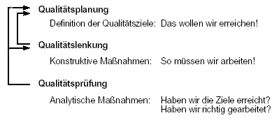

Leiten und Lenken bezüglich Qualität umfassen üblicherweise das Festlegen der Qualitätspolitik und der Qualitätsziele, die Qualitätsplanung, die Qualitätslenkung, die Qualitätssicherung und die Qualitätsverbesserung.

Qualitätsmanagementsysteme kann man überprüfen lassen. Diese Überprüfungen werden von Zertifizierungsgesellschaften durchgeführt. Sie stellen sogenannte **Zertifikate** aus, welche während einer bestimmten Dauer gültig sind. Während dieser Gültigkeitsdauer müssen Zwischenprüfungen durchgeführt werden, diese nennt man **Audits**.

Die Zertifizierungsgesellschaften ihrerseits werden von staatlichen Behörden regelmässig überprüft. In der Schweiz durch das Metas (Metas = Metrologie und Akkreditierung Schweiz, ein Amt im Justiz und Polizeidepartement).

Damit ein solches QM-System überprüfbar ist, muss es natürlich auch beschrieben (definiert) sein. Dies wird in einem Handbuch festgelegt und es enthält üblicherweise alle Elemente des QM-Systems.

**Anmerkungen:**

-   Qualität entsteht nicht von selbst, sie muss definiert und geschaffen werden.
-   Qualität bezieht sich sowohl auf  
    **Produkte** als auch auf  
    **Prozesse.**  
    In vielen Fällen werden Projekte gebildet, um diese Produkte herzustellen, diese Projekte müssen nach einer geeigneten Vorgehensweise (Prozess) durchgeführt werden.
-   Qualitätsmanagement ist eine unternehmerische Aufgabe.
-   Die Wichtigkeit der geforderten Qualität ist vom Produkt bzw. der Anwendung abhängig.

## Forderungen der Norm ISO 9001

In der am weitesten verbreiteten Norm für Qualitätsmanagementsysteme, ISO 9001, werden folgende Elemente gefordert:

-   Verantwortung der Leitung (Management, Geschäftsführung)
-   Qualitätssicherungssystem
-   Vertragsprüfung
-   Designlenkung
-   Lenkung der Dokumente und Daten
-   Beschaffung
-   Lenkung der vom Kunden beigestellten Produkte
-   Kennzeichnung und Rückverfolgbarkeit von Produkten
-   Prozesslenkung
-   Prüfungen
-   Prüfmittelüberwachung
-   Prüfstatus
-   Lenkung fehlerhafter Produkte
-   Korrektur- und Vorbeugungsmassnahmen
-   Handhabung, Lagerung, Verpackung, Konservierung und Versand
-   Lenkung von Qualitätsaufzeichnungen
-   Interne Qualitätsaudits
-   Schulung
-   Wartung (Instandhaltung)
-   Statistische Methoden

### Prüfplan

Die „abgespeckte“ Version einer Qualitätsplanung ist der Prüfplan. Er dient dazu, den Beteiligten aufzuzeigen, wie, wann und welche Ergebnisse geprüft werden. Der Prüfplan besteht aus:

-   Der Aufzählung der zu überprüfenden Objekte   
    („Prüflinge“, Ergebnis oder Teilergebnis)
-   Die anzuwendende Prüfart pro Prüfungsobjekt
-   Prüfungsziel pro Objekt
-   Prüfaspekte (für die Prüfung massgebende Kriterien)
-   Prüfumgebung (z.B. auf welcher Anlage geprüft wird)
-   Verantwortliche Stellen (Autor, Gutacher, usw.)
-   Prüfungsaufwand und –Kosten
-   Vorgaben, wie die Prüfung zu dokumentieren ist
-   Sonstigen Bemerkungen

Der Prüfplan wird in der Testphase abgearbeitet und ist somit ein eigener, kleiner „Unterprojektplan“. Meistens sind im Projektplan nicht die einzelnen Details ersichtlich, sondern nur die Phase an sich.

Wie lange dauert die Testphase?

**Summe aus:**

-   **Dauer für die Durchführung des Prüfplans**
-   **Dauer für die Korrektur eventueller Fehler**
-   **Dauer für die erneute Durchführung des Prüfplans, diesmal an den korrigierten Objekten**

## Prinzipien eines modernen Qualitätsmanagementsystems

Heutige Qualitätsmanagementsysteme orientieren sich an der Selbstverantwortung aller Beteiligten sowie an der Kundenzufriedenheit. Dieser Ansatz wurde hauptsächlich von Deming (1986) entwickelt und propagiert. Zur Realisierung wird heute meist ein prozessorientierter, systemischer Ansatz verwendet.

Wie in der unten abgebildeten Grafik sichtbar, kann man mehrere geschlossene Kreise definieren, man spricht von Regelkreisen:

-   **Kunden**: Pflege der Beziehung, Erfassen der Kundenwünsche bzw. -forderungen, Ermitteln der Kundenzufriedenheit
-   **Prozesse**: Ziele definieren, Projekte planen, Bearbeiten, Vergleichen mit dem Erreichten.

Wenn man dies konsequent anwendet, erhält man ein gutes Werkzeug zur   
**ständigen Verbesserung** aller Prozesse.

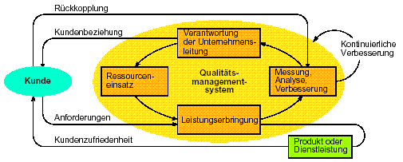

Viele Unternehmen haben das Qualitätsmanagement zur Unternehmensphilosophie erhoben und wenden es auch in Bereichen über die Normforderungen hinaus an. Dies führte zum Begriff

**Total Quality Management** kurz: TQM.

### Moderne integrierte Management-Systeme

TQM-Systeme (TQM = **T***otal* **Q***uality* **M***anagement*) werden von fortschrittlichen Unternehmen heute immer häufiger umgesetzt. Das unten abgebildete Modell zeigt zwei Bereiche: links die zu planenden Elemente und rechts die Beurteilung "wie gut haben wir gearbeitet".

Bei TQM erstreckt sich Qualitätssicherung auf den gesamten Bearbeitungsprozess, dabei bezieht es sich nicht nur auf Produkte und Dienstleistungen, sondern auch auf die Wertschöpfungsprozesse, auf die Arbeitsbedingungen und auf die Umwelt. Deshalb wird der Qualitätsanspruch zu einem Erfolgsindikator im gesamten Wertschöpfungsprozess. Alle Mitarbeiter sind in die Wertschöpfungskette eingebunden, jeder Mitarbeiter sollte sich mit einem (Geschäfts-) Prozess identifizieren können, sonst ist er entweder überflüssig oder es wurden nicht alle Prozesse beschrieben!

Wichtige Voraussetzungen sind dabei (immer mehr) die **Kundenorientierung** und die **Mitarbeiterzufriedenheit** (-qualifikation).

Z.B. können Kundenreklamationen in einem Formular eingetragen werden, die aufbereiteten Daten dann den zuständigen Mitarbeitern in Entwicklung, Produktmanagement, Kundenbetreuer, Service, usw. zur Verfügung gestellt werden.

Andi Rengel, Walter Eiden, Walter Steiner, Michael Kellenberger

22.10.2019 17:22:00

M306_0_Skript_V3.1.1.docx
